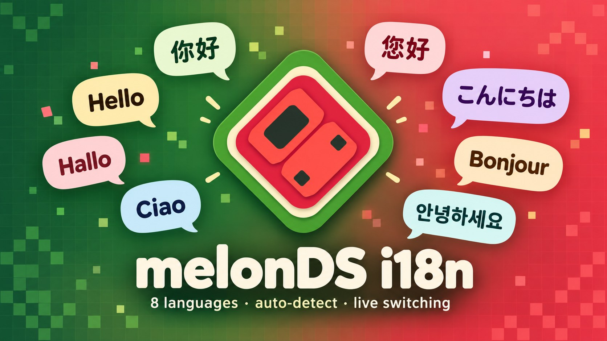
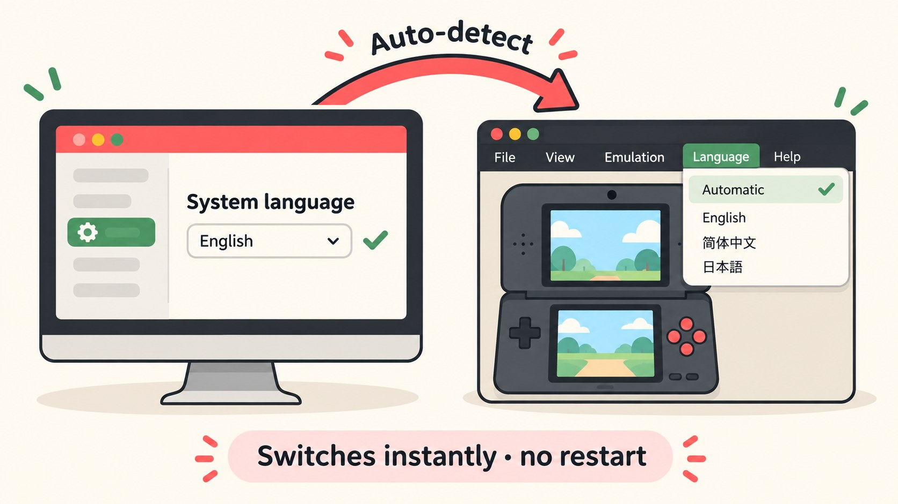

<h1 align="center">melonDS i18n</h1>

<b>多语言版 melonDS 任天堂 DS 模拟器</b> · The multilingual edition of the melonDS Nintendo DS emulator

<a href="#简体中文">简体中文</a> ·
<a href="#english">English</a> ·
<a href="#other-languages">繁體中文 · 日本語 · Deutsch · Français · 한국어 · Italiano</a>

---

## 简体中文

**melonDS i18n** 是 [melonDS](https://github.com/melonDS-emu/melonDS) 的非官方多语言分支。模拟核心与上游完全一致，只是把整个界面做成了标准的 Qt 多语言（i18n）架构：菜单、所有设置窗口、提示和错误信息，以及游戏画面上弹出的 OSD 提示（如“已保存即时存档到槽位 1”）都已翻译。

### 支持的语言

| 语言 | 代码 | 状态 |
|---|---|---|
| 简体中文 | `zh_CN` | 745 / 745 |
| 繁體中文（台湾用语） | `zh_TW` | 745 / 745 |
| English | `en` | 原文 |
| 日本語 | `ja` | 745 / 745 |
| Deutsch | `de` | 745 / 745 |
| Français | `fr` | 745 / 745 |
| 한국어 | `ko` | 745 / 745 |
| Italiano | `it` | 745 / 745 |

### 自动识别与切换

- **自动识别**：默认跟随电脑的系统语言。繁体系统（台湾、香港、澳门）显示繁體中文，其他中文系统显示简体中文；日、德、法、韩、意按系统语言匹配；不在列表里的语言显示英文。
- **菜单栏切换**：点菜单栏上的 **语言 / Language**，选择“自动”或任意一种语言。每种语言都用它自己的文字显示，看不懂当前界面也能找到。
- **设置窗口**：也可以在“设置 → 界面设置 → 语言”中选择，两处保持同步。
- **立即生效**：切换后菜单和游戏内提示马上变成新语言，无需重启。已经打开的设置窗口关掉重开即可。
- Qt 自带的标准按钮和文件选择窗口也会跟着切换。

### 下载

到 [Releases](https://github.com/doomsday616/melonDS-i18n/releases/latest) 下载最新版本：

| 系统 | 文件 |
|---|---|
| Windows（普通电脑） | `windows-x86_64.zip`，解压后运行 `melonDS.exe` |
| Windows（ARM 电脑） | `windows-arm64.zip` |
| Linux | `linux-x86_64.AppImage` / `linux-aarch64.AppImage` |
| macOS（Intel 与 Apple 芯片通用） | `macos-universal.zip` |

### 贡献翻译

翻译文件位于 [`src/frontend/qt_sdl/translations/`](src/frontend/qt_sdl/translations/)，格式是 Qt Linguist 的 `.ts`。修改后用 `lupdate` / `lrelease` 重新生成 `.qm`（命令写在 `src/frontend/qt_sdl/CMakeLists.txt` 的注释里）。翻译问题请在本仓库提交 [Issue](https://github.com/doomsday616/melonDS-i18n/issues)，请勿反馈到上游 melonDS。

---

## English

**melonDS i18n** is an unofficial fork of [melonDS](https://github.com/melonDS-emu/melonDS). The emulator core is identical to upstream; the Qt frontend has been turned into a proper i18n build. Menus, every settings dialog, messages and the on-screen (OSD) notifications are translated into 8 languages: Simplified Chinese, Traditional Chinese (Taiwan), English, Japanese, German, French, Korean and Italian.

- **Auto-detect:** the UI follows the system language by default; unsupported languages fall back to English.
- **Language menu:** pick a language from the **Language** menu in the menu bar (or Config → Interface settings). Each language is listed by its native name.
- **Live switching:** changes apply immediately, no restart needed. Qt's standard buttons and file dialogs follow as well.
- **Downloads:** Windows x86_64 / arm64, Linux x86_64 / aarch64 AppImage and macOS universal builds are on the [Releases](https://github.com/doomsday616/melonDS-i18n/releases/latest) page.
- **Translations** live in `src/frontend/qt_sdl/translations/` as Qt Linguist `.ts` files. Please report translation issues [here](https://github.com/doomsday616/melonDS-i18n/issues), not upstream.

---

## Other languages

- **繁體中文：** melonDS 的非官方多語言分支，介面、設定視窗與遊戲內提示皆已翻譯，預設跟隨系統語言，也可從選單列的「語言」即時切換，無需重新啟動。
- **日本語：** melonDS の非公式多言語版です。メニュー、設定画面、画面上の通知まで翻訳済み。システム言語を自動検出し、メニューバーの「言語」から再起動なしで切り替えられます。
- **Deutsch:** Inoffizielle mehrsprachige Version von melonDS. Menüs, Einstellungen und Bildschirmmeldungen sind übersetzt. Die Sprache folgt dem System und lässt sich im Menü „Sprache“ ohne Neustart wechseln.
- **Français :** version multilingue non officielle de melonDS. Menus, réglages et messages à l'écran sont traduits. La langue suit celle du système et peut être changée sans redémarrage via le menu « Langue ».
- **한국어:** melonDS의 비공식 다국어 버전입니다. 메뉴, 설정 창, 화면 알림까지 번역되어 있으며, 시스템 언어를 자동으로 따르고 메뉴 막대의 「언어」에서 재시작 없이 바꿀 수 있습니다.
- **Italiano:** versione multilingue non ufficiale di melonDS. Menu, impostazioni e messaggi a schermo sono tradotti. La lingua segue quella di sistema e si può cambiare senza riavvio dal menu «Lingua».

---

<b>Original melonDS README</b>

<h2 align="center"><b>melonDS</b></h2>

 

DS emulator, sorta

The goal is to do things right and fast, akin to blargSNES (but hopefully better). But also to, you know, have a fun challenge :)

## How to use

Firmware boot (not direct boot) requires a BIOS/firmware dump from an original DS or DS Lite.
DS firmwares dumped from a DSi or 3DS aren't bootable and only contain configuration data, thus they are only suitable when booting games directly.

### Possible firmware sizes

 * 128KB: DSi/3DS DS-mode firmware (reduced size due to lacking bootcode)
 * 256KB: regular DS firmware
 * 512KB: iQue DS firmware

DS BIOS dumps from a DSi or 3DS can be used with no compatibility issues. DSi BIOS dumps (in DSi mode) are not compatible. Or maybe they are. I don't know.

As for the rest, the interface should be pretty straightforward. If you have a question, don't hesitate to ask, though!

## How to build
See [BUILD.md](./BUILD.md) for build instructions.

## TODO LIST

 * better DSi emulation
 * better OpenGL rendering
 * netplay
 * the impossible quest of pixel-perfect 3D graphics
 * support for rendering screens to separate windows
 * emulating some fancy addons
 * other non-core shit (debugger, graphics viewers, etc)

### TODO LIST FOR LATER (low priority)

 * big-endian compatibility (Wii, etc)
 * LCD refresh time (used by some games for blending effects)
 * any feature you can eventually ask for that isn't outright stupid

## Credits

 * Martin for GBAtek, a good piece of documentation
 * Cydrak for the extra 3D GPU research
 * limittox for the icon
 * All of you comrades who have been testing melonDS, reporting issues, suggesting shit, etc

## Licenses

melonDS is free software: you can redistribute it and/or modify
it under the terms of the GNU General Public License as published by
the Free Software Foundation, either version 3 of the License, or
(at your option) any later version.

### External
* Images used in the Input Config Dialog - see `src/frontend/qt_sdl/InputConfig/resources/LICENSE.md`

