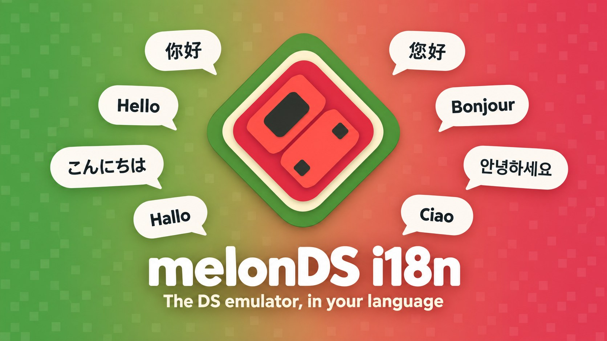
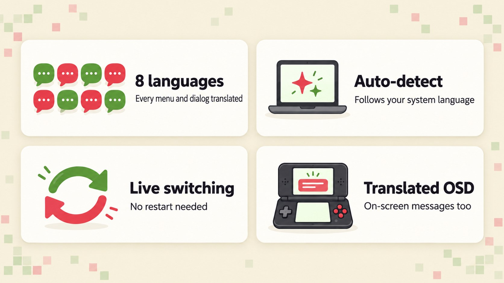
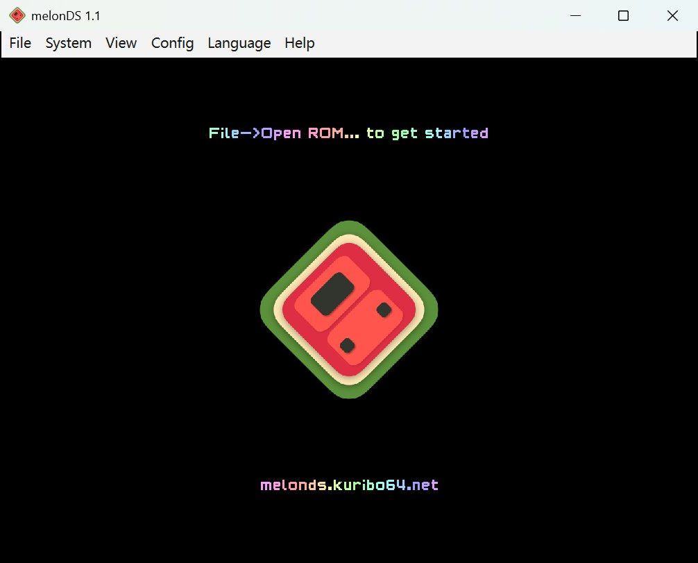
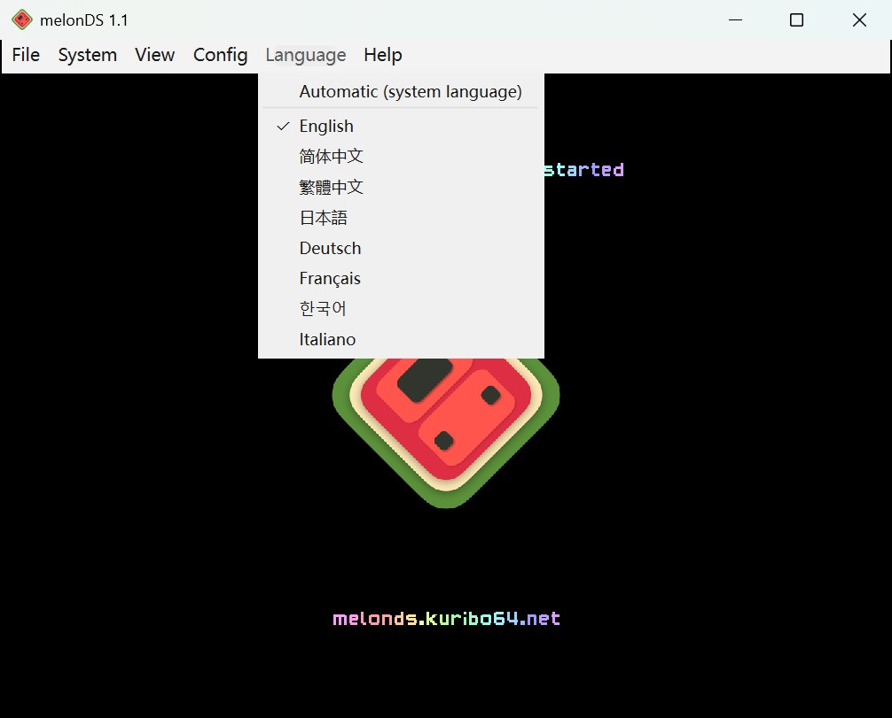
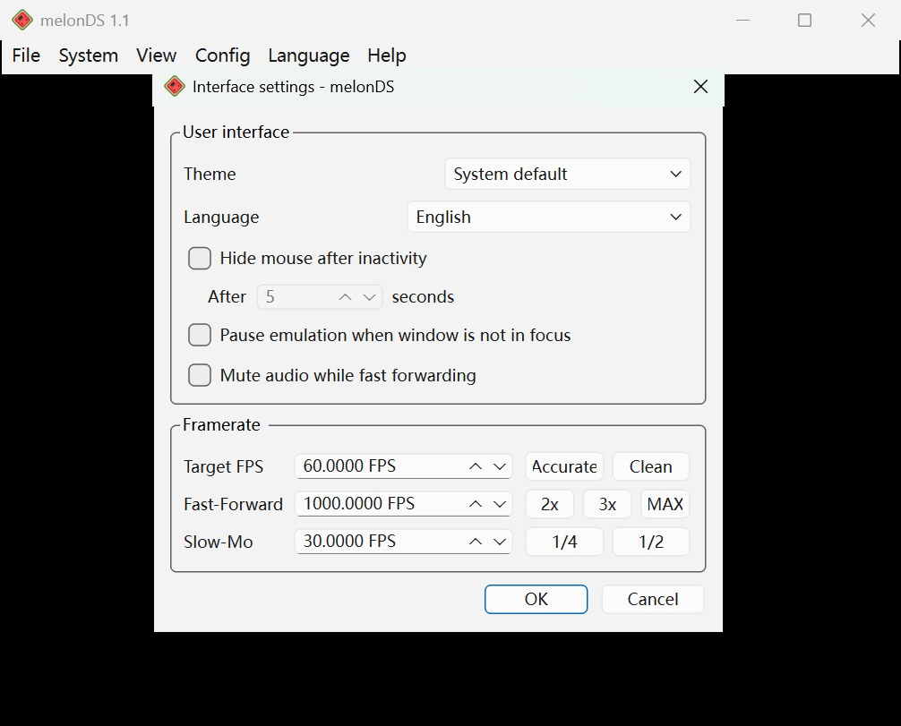
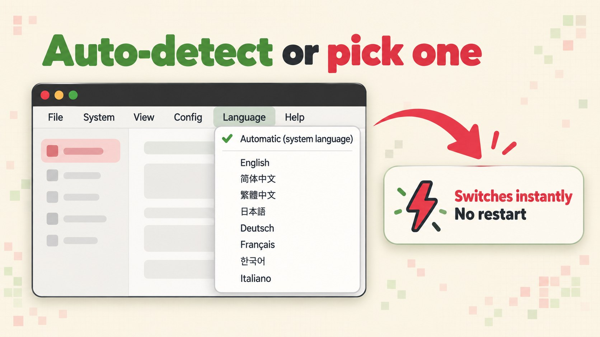
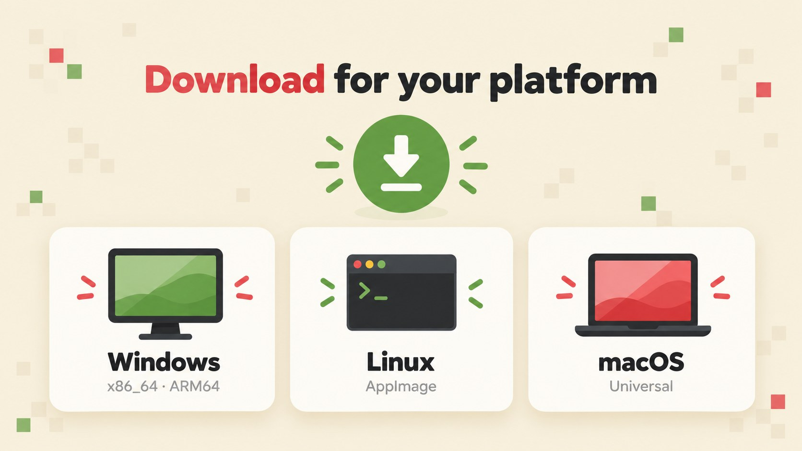
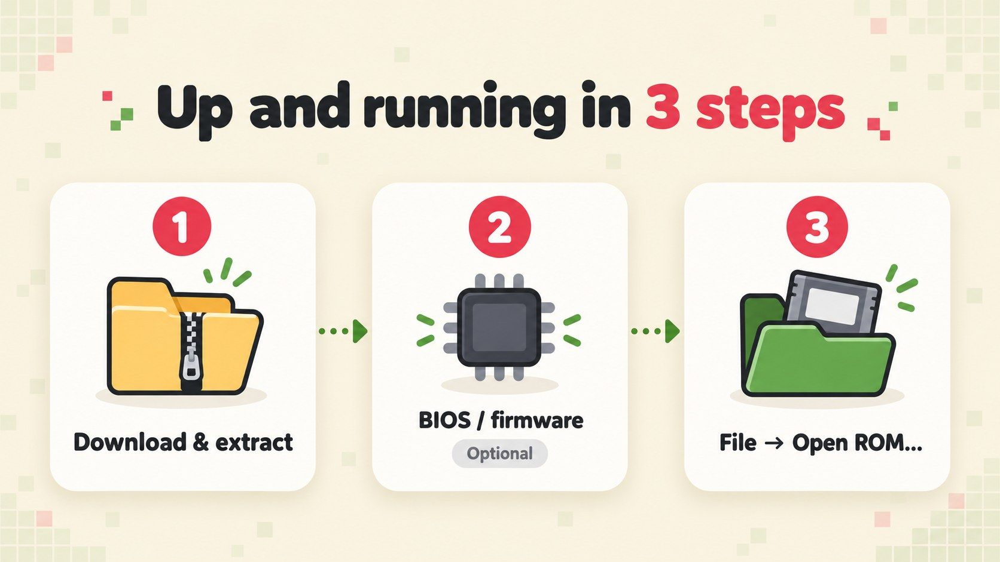

<b>English</b> ·
<a href="docs/readme/README.zh-CN.md">简体中文</a> ·
<a href="docs/readme/README.zh-TW.md">繁體中文</a> ·
<a href="docs/readme/README.ja.md">日本語</a> ·
<a href="docs/readme/README.de.md">Deutsch</a> ·
<a href="docs/readme/README.fr.md">Français</a> ·
<a href="docs/readme/README.ko.md">한국어</a> ·
<a href="docs/readme/README.it.md">Italiano</a>

# melonDS i18n

**melonDS i18n** is an unofficial multilingual fork of [melonDS](https://github.com/melonDS-emu/melonDS), the Nintendo DS emulator. It is based on melonDS 1.1 and the emulator core is identical to upstream — games run exactly the same. What changes is the Qt frontend: it has been turned into a proper Qt Linguist i18n build, so menus, every settings dialog, messages and even the on-screen notifications appear in your language. Eight languages ship today, all fully translated.

## Features

- **8 languages** — Simplified Chinese, Traditional Chinese (Taiwan terms), English, Japanese, German, French, Korean and Italian.
- **Auto-detect** — the interface follows your system language out of the box.
- **Live switching** — change language from the **Language** menu; it applies instantly, no restart.
- **Translated OSD** — on-screen notifications such as "State saved to slot 1" are translated too, rendered with a system font that supports CJK and accented characters.
- **Qt's own widgets follow along** — standard buttons and file dialogs switch language as well.

## Screenshots

 <em>The main window</em>

 <em>The Language menu, with every language listed by its native name</em>

 <em>A settings dialog</em>

## Supported languages

| Language | Code | Status |
|---|---|---|
| 简体中文 (Simplified Chinese) | `zh_CN` | 745 / 745 |
| 繁體中文 (Traditional Chinese, Taiwan terms) | `zh_TW` | 745 / 745 |
| English | `en` | Source language |
| 日本語 (Japanese) | `ja` | 745 / 745 |
| Deutsch (German) | `de` | 745 / 745 |
| Français (French) | `fr` | 745 / 745 |
| 한국어 (Korean) | `ko` | 745 / 745 |
| Italiano (Italian) | `it` | 745 / 745 |

## Auto-detect and switching

By default melonDS i18n picks a language from your system UI language:

| System language | Interface language |
|---|---|
| Chinese — Traditional script, Taiwan, Hong Kong or Macau (`zh-Hant`, `zh-TW`, `zh-HK`, `zh-MO`) | 繁體中文 |
| Any other Chinese | 简体中文 |
| Japanese, German, French, Korean, Italian | the matching language |
| Anything else | English |

To choose a language yourself:

- Open the **Language** menu in the menu bar (between **Config** and **Help**). In a non-English interface it is titled with both names, e.g. **语言 / Language**, so you can always find your way back.
- Pick **Automatic (system language)** or any language. Languages are listed by their native names: English, 简体中文, 繁體中文, 日本語, Deutsch, Français, 한국어, Italiano.
- The same choice is also available under **Config → Interface settings → Language**; both places stay in sync.

The switch is immediate — menus and on-screen messages change on the spot. Dialogs that were already open pick up the new language once you close and reopen them.

## Download

Grab the latest build from the [Releases page](https://github.com/doomsday616/melonDS-i18n/releases/latest):

| Platform | File |
|---|---|
| Windows (x86_64, most PCs) | `melonDS-1.1-i18n-windows-x86_64.zip` |
| Windows (ARM64) | `melonDS-1.1-i18n-windows-arm64.zip` |
| Linux (x86_64) | `melonDS-1.1-i18n-linux-x86_64.AppImage` |
| Linux (aarch64) | `melonDS-1.1-i18n-linux-aarch64.AppImage` |
| macOS (Intel and Apple silicon) | `melonDS-1.1-i18n-macos-universal.zip` |

The Windows zip contains just `melonDS.exe`. It is portable: nothing is installed, and settings are written next to the executable.

## Quick start

1. **Download and extract** the build for your platform (on Linux, make the AppImage executable and run it).
2. **BIOS / firmware (optional).** Thanks to the built-in FreeBIOS, most games boot directly without any dumps. If you want to boot through the DS firmware menu, or use DSi mode, set up your own dumps under **Config → Emu settings**.
3. **Load a game** with **File → Open ROM...** and pick a ROM you dumped from a cartridge you own.

## FAQ

**macOS says the app is from an unidentified developer.**
The builds are not signed. Right-click the app and choose **Open**, or go to **System Settings → Privacy & Security** and click **Open Anyway**.

**Windows SmartScreen warns me.**
Same reason — the executable is unsigned. Click **More info**, then **Run anyway**.

**On Linux, Chinese/Japanese/Korean on-screen messages show up as boxes.**
The OSD draws text with a system font. Install a CJK font such as Noto Sans CJK (for example `fonts-noto-cjk` on Debian/Ubuntu) and restart melonDS.

**What are the BIOS and firmware files, and where do I get them?**
They are the boot code and settings stored inside a real console. melonDS ships FreeBIOS, so they are optional for direct boot. Booting the firmware menu needs dumps from an original DS or DS Lite (the 128 KB DS-mode firmware from a DSi or 3DS is not bootable). DSi mode needs DSi BIOS and NAND dumps. The only legal source is dumping them from a console you own; this project does not link to download sites.

**I switched languages but an open dialog is still in the old language.**
That is expected. Close the dialog and open it again.

**Where are my settings stored?**
On Windows, in `melonDS.toml` next to `melonDS.exe`. On Linux and macOS, in the `melonDS` folder of your user config directory (for example `~/.config/melonDS/`), unless a `portable` folder exists next to the executable.

## Contributing translations

Translations live in [`src/frontend/qt_sdl/translations/`](src/frontend/qt_sdl/translations/) as Qt Linguist files named `melonDS_<lang>.ts`. The compiled `.qm` files, Qt's own `qtbase_<lang>.qm` and `translations.qrc` are committed next to them and embedded into the executable.

1. If source strings changed, refresh the `.ts` files:
   `lupdate -no-obsolete -locations none src/frontend/qt_sdl -ts src/frontend/qt_sdl/translations/melonDS_*.ts`
2. Translate in Qt Linguist (or edit the `.ts` XML directly).
3. Compile the translations:
   `lrelease src/frontend/qt_sdl/translations/melonDS_*.ts`
4. Rebuild melonDS — the `.qm` files are embedded via `translations.qrc`.

The exact commands are also kept in a comment in `src/frontend/qt_sdl/CMakeLists.txt`. Please report translation problems in [this repository's issues](https://github.com/doomsday616/melonDS-i18n/issues), not to upstream melonDS.

## Credits and license

- melonDS is made by the melonDS team — Arisotura and contributors. Upstream: [melonDS-emu/melonDS](https://github.com/melonDS-emu/melonDS).
- melonDS icon by limittox.
- Build instructions and the full upstream credits are in the [upstream melonDS repository](https://github.com/melonDS-emu/melonDS).

melonDS i18n is free software released under the [GNU General Public License v3](https://www.gnu.org/licenses/gpl-3.0), the same license as melonDS.
