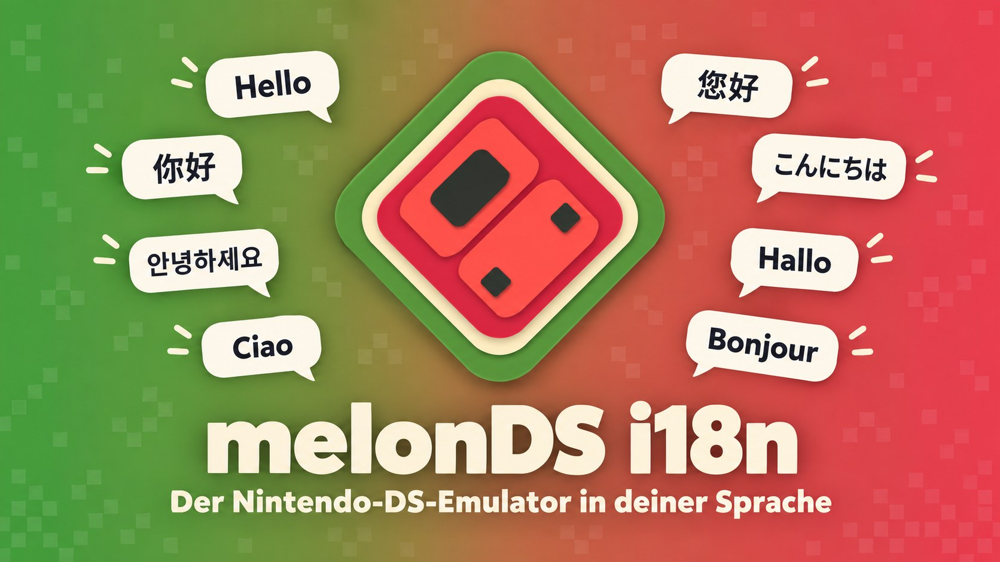
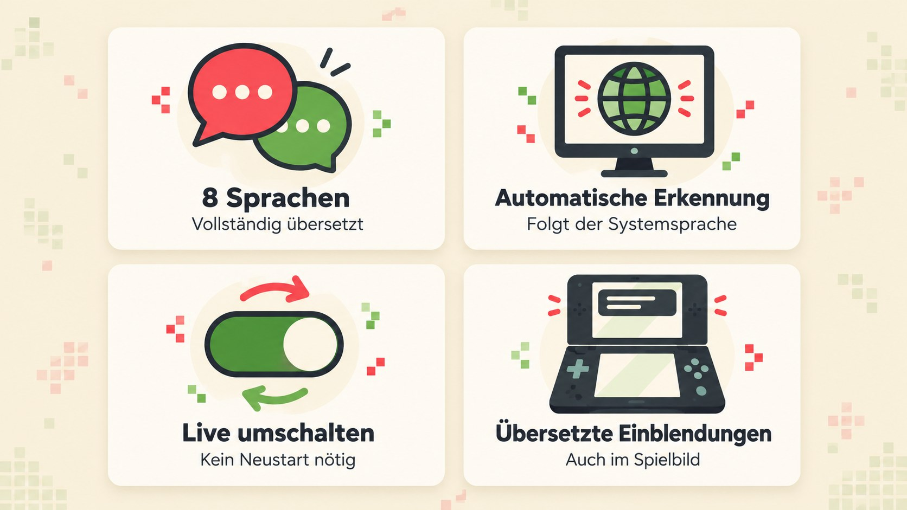
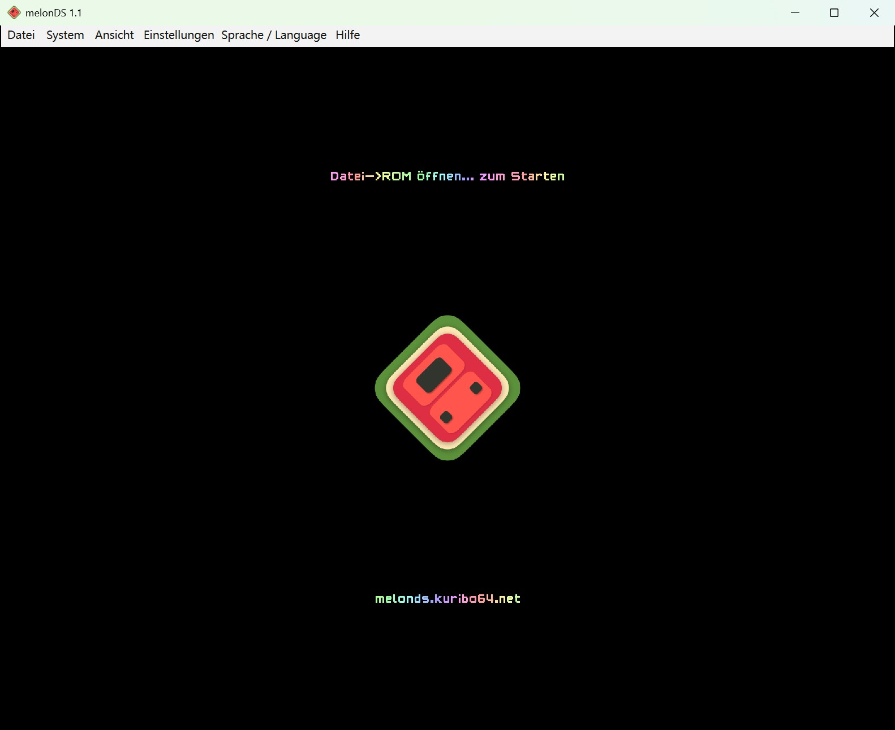
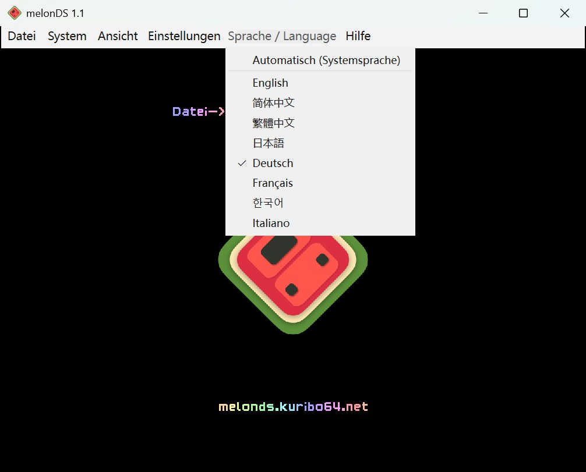
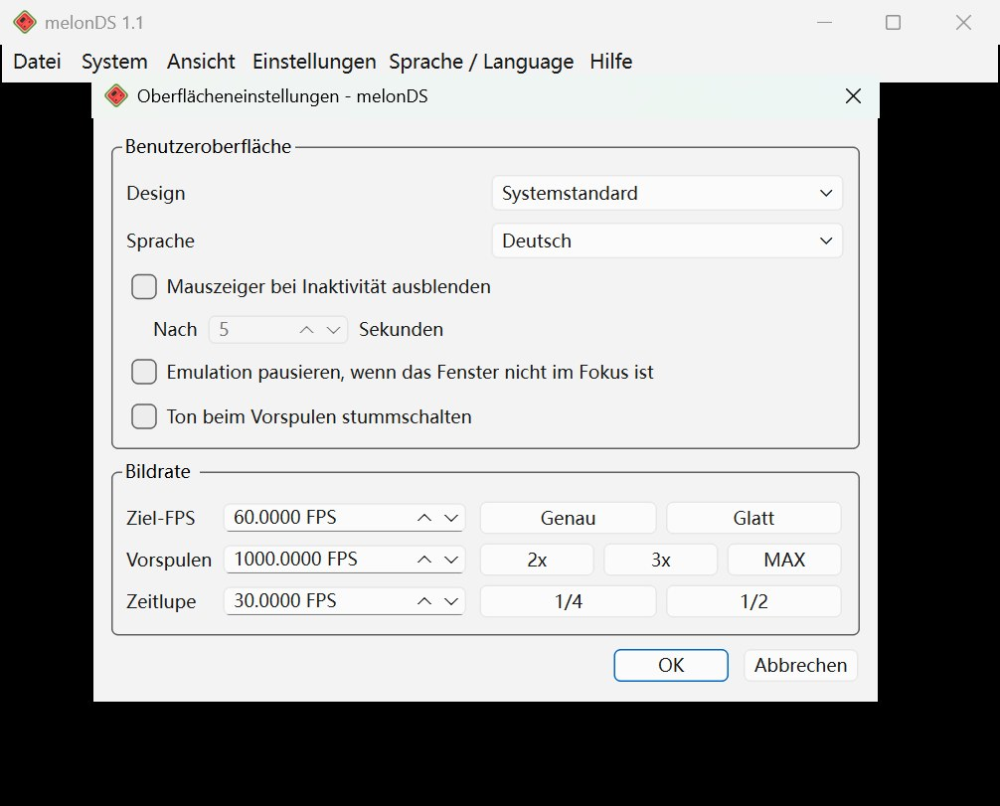
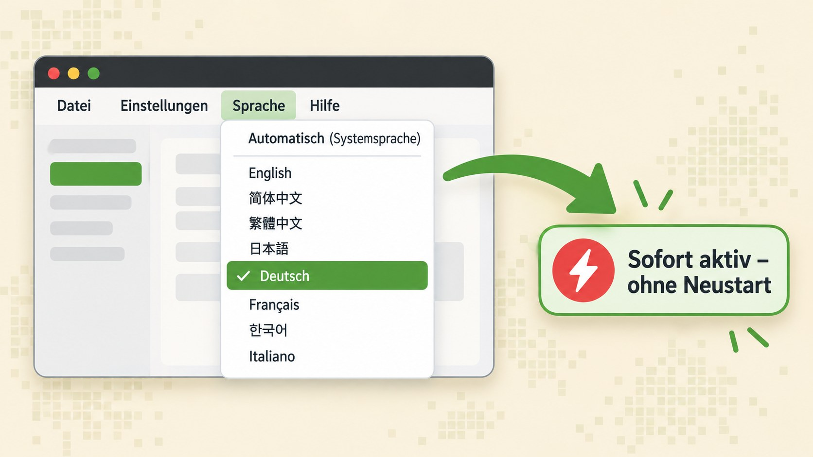
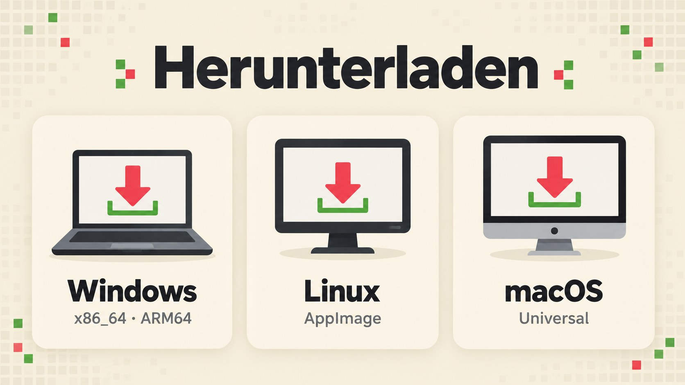
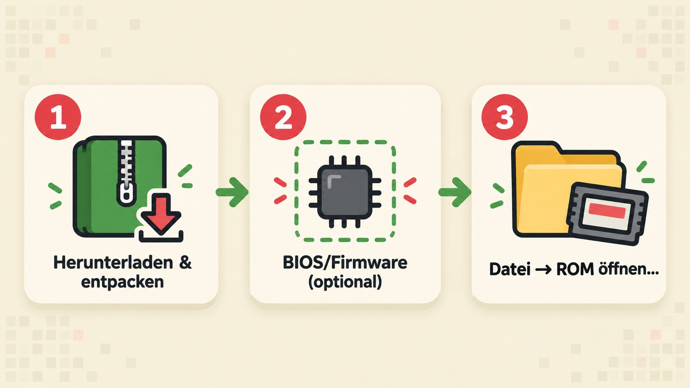

<p align="center"></p>

<p align="center">
<a href="../../README.md">English</a> ·
<a href="README.zh-CN.md">简体中文</a> ·
<a href="README.zh-TW.md">繁體中文</a> ·
<a href="README.ja.md">日本語</a> ·
<b>Deutsch</b> ·
<a href="README.fr.md">Français</a> ·
<a href="README.ko.md">한국어</a> ·
<a href="README.it.md">Italiano</a>
</p>

<p align="center">
<a href="https://github.com/doomsday616/melonDS-i18n/releases/latest"></a>
<a href="https://github.com/doomsday616/melonDS-i18n/actions/workflows/build-windows.yml"></a>
<a href="https://github.com/doomsday616/melonDS-i18n/actions/workflows/build-ubuntu.yml"></a>
<a href="https://github.com/doomsday616/melonDS-i18n/actions/workflows/build-macos.yml"></a>
<a href="https://github.com/doomsday616/melonDS-i18n/actions/workflows/build-bsd.yml"></a>
<a href="https://www.gnu.org/licenses/gpl-3.0"></a>
</p>

# melonDS i18n

**melonDS i18n** ist ein inoffizieller, mehrsprachiger Fork des Nintendo-DS-Emulators [melonDS](https://github.com/melonDS-emu/melonDS) auf Basis von Version 1.1. Der Emulationskern ist unverändert identisch mit dem Original – geändert wurde nur die Qt-Oberfläche, die zu einer sauberen Qt-Linguist-Lokalisierung umgebaut wurde. Menüs, sämtliche Einstellungsdialoge, Meldungen und sogar die Einblendungen im Spielbild erscheinen damit in deiner Sprache.

## Funktionen

<p align="center"></p>

- **8 Sprachen, vollständig übersetzt** – jede Sprache deckt alle 775 Texte der Oberfläche ab.
- **Automatische Erkennung** – beim ersten Start wird die Sprache des Betriebssystems übernommen.
- **Live umschalten** – Sprache wechseln ohne Neustart des Emulators.
- **Übersetzte Einblendungen (OSD)** – etwa „Speicherstand in Slot 1 gespeichert“ direkt im Spielbild.
- **Auch Qt-Standardelemente** – Schaltflächen wie „OK“/„Abbrechen“ und Dateidialoge folgen der gewählten Sprache (mitgelieferte `qtbase_*.qm`).
- **Neu in 1.1.0** – belegbare Tastenkürzel für Schnell-Speicherstände (Slot 1) und für Screenshots (Zielordner in den Pfadeinstellungen), optionale Rückfrage vor Zurücksetzen/Stoppen (Oberflächeneinstellungen) und `.srm`-Dateien beim Importieren von Spielständen.
- **Neu in 1.2.0** – neue belegbare Tastenkürzel zum Durchschalten der Bildschirmanordnung, für gleiche Bildschirmgrößen, zum Neuladen des zuletzt geöffneten ROMs und zum Ausblenden der Menüleiste; benutzerdefinierter Bildschirmabstand (Ansicht > Bildschirmabstand > Benutzerdefiniert...); Lautstärkeregler für Vorspulen und Zeitlupe (Oberflächeneinstellungen); optionale automatische Controller-Belegung und eigene Belegungen pro Controller-Modell (beides standardmäßig aus, bestehende Belegungen bleiben erhalten); interne Auflösung bis 22x; der OpenGL-Renderer läuft jetzt auch mit OpenGL 3.1.

## Screenshots

<p align="center">



</p>
<p align="center"><sub>Hauptfenster · Menü „Sprache / Language“ · Einstellungsdialog – alles auf Deutsch</sub></p>

## Unterstützte Sprachen

| Sprache | Code | Übersetzt |
|---|---|---|
| English | `en` | Ausgangssprache |
| 简体中文 (vereinfachtes Chinesisch) | `zh_CN` | 775 / 775 |
| 繁體中文 (traditionelles Chinesisch, taiwanische Begriffe) | `zh_TW` | 775 / 775 |
| 日本語 (Japanisch) | `ja` | 775 / 775 |
| Deutsch | `de` | 775 / 775 |
| Français (Französisch) | `fr` | 775 / 775 |
| 한국어 (Koreanisch) | `ko` | 775 / 775 |
| Italiano (Italienisch) | `it` | 775 / 775 |

<p align="center"></p>

## Automatische Erkennung und Sprachwechsel

<p align="center"></p>

Standardmäßig ist **„Automatisch (Systemsprache)“** aktiv. melonDS i18n liest dann die Anzeigesprache des Systems:

| Systemsprache | Oberfläche |
|---|---|
| Chinesisch, traditionell (zh-Hant, Taiwan, Hongkong, Macau) | 繁體中文 |
| Chinesisch, alle anderen Varianten | 简体中文 |
| Japanisch, Deutsch, Französisch, Koreanisch, Italienisch | jeweilige Sprache |
| alles andere | English |

Selbst wählen kannst du an zwei Stellen, die immer synchron bleiben:

1. Im Menü **„Sprache / Language“** zwischen „Einstellungen“ und „Hilfe“. Der englische Zusatz im Titel sorgt dafür, dass man das Menü auch in einer fremden Sprache wiederfindet.
2. Unter **Einstellungen → Oberflächeneinstellungen → Sprache**.

Die Sprachnamen stehen immer in ihrer eigenen Schreibweise (English, 简体中文, 繁體中文, 日本語, Deutsch, Français, 한국어, Italiano). Der Wechsel greift sofort, ohne Neustart. Bereits geöffnete Dialoge zeigen die neue Sprache, sobald du sie erneut öffnest.

## Herunterladen

<p align="center"></p>

Alle Pakete gibt es unter [Releases → latest](https://github.com/doomsday616/melonDS-i18n/releases/latest):

| Plattform | Datei |
|---|---|
| Windows (x86_64) | `melonDS-i18n-1.2.0-windows-x86_64.zip` |
| Windows (ARM64) | `melonDS-i18n-1.2.0-windows-arm64.zip` |
| Linux (x86_64) | `melonDS-i18n-1.2.0-linux-x86_64.AppImage` |
| Linux (aarch64) | `melonDS-i18n-1.2.0-linux-aarch64.AppImage` |
| macOS (Universal, Intel + Apple Silicon) | `melonDS-i18n-1.2.0-macos-universal.zip` |

Das Windows-Archiv enthält nur `melonDS.exe` und ist portabel: Es wird nichts installiert, die Einstellungen landen in `melonDS.toml` im selben Ordner.

Version 1.2.0 enthält insgesamt 38 Korrekturen und Funktionen auf Basis von Pull Requests, die im Original-melonDS noch nicht übernommen wurden: die 22 aus früheren Versionen und 16 neue. Die [Release Notes zu v1.2.0](https://github.com/doomsday616/melonDS-i18n/releases/tag/v1.2.0) beschreiben die neuen, die Release Notes zu [v1.1.0](https://github.com/doomsday616/melonDS-i18n/releases/tag/v1.1.0) und [v1.0.0](https://github.com/doomsday616/melonDS-i18n/releases/tag/v1.0.0) die früheren.

## Schnellstart

<p align="center"></p>

1. **Herunterladen und entpacken** – das passende Paket für dein System laden, entpacken bzw. die AppImage ausführbar machen und starten.
2. **BIOS/Firmware (optional)** – dank des eingebauten FreeBIOS laufen viele Spiele per Direktstart auch ohne eigene Dateien. Wer das echte Firmware-Menü booten oder den DSi-Modus nutzen will, hinterlegt seine Dumps unter **Einstellungen → Emulatoreinstellungen** (Reiter **DS-Modus** und **DSi-Modus**).
3. **Spiel laden** – über **Datei → ROM öffnen...** eine eigene ROM auswählen.

## FAQ

**macOS meldet „nicht verifizierter Entwickler“.**
Die Builds sind nicht signiert. Versuche die App einmal zu öffnen, klicke dann unter **Systemeinstellungen → Datenschutz & Sicherheit** im Bereich „Sicherheit“ auf **Dennoch öffnen** und bestätige mit deinem Passwort.

**Windows SmartScreen warnt beim Start.**
Ebenfalls wegen der fehlenden Signatur. Auf **Weitere Informationen** und dann **Trotzdem ausführen** klicken.

**Unter Linux fehlen chinesische, japanische oder koreanische Zeichen in den Einblendungen.**
Die Einblendungen nutzen für solche Zeichen eine Systemschrift. Installiere eine CJK-Schrift, z. B. Noto Sans CJK – `fonts-noto-cjk` unter Debian/Ubuntu, `noto-fonts-cjk` unter Arch, `google-noto-sans-cjk-fonts` unter Fedora – und starte melonDS neu.

**Brauche ich BIOS- oder Firmware-Dateien?**
Für den Direktstart nicht – FreeBIOS ist eingebaut. Zum Booten der Firmware brauchst du Dumps eines eigenen DS oder DS Lite; die 128-KB-Firmware aus dem DS-Modus eines DSi oder 3DS ist nicht bootfähig. Der DSi-Modus benötigt DSi-BIOS- und NAND-Dumps. Die einzige legale Quelle ist deine eigene Konsole – dieses Projekt verlinkt keine Download-Seiten für BIOS oder ROMs.

**Nach dem Sprachwechsel ist ein offenes Fenster noch in der alten Sprache.**
Das ist erwartet: Bereits geöffnete Dialoge einfach schließen und erneut öffnen.

**Wo werden die Einstellungen gespeichert?**
Unter Windows in `melonDS.toml` neben `melonDS.exe`. Unter Linux und macOS im Ordner `melonDS` deines Benutzer-Konfigurationsverzeichnisses (z. B. `~/.config/melonDS/`), außer neben dem Programm liegt ein Ordner `portable`.

## Übersetzungen beitragen

<p align="center"></p>

1. Die Datei `src/frontend/qt_sdl/translations/melonDS_<sprache>.ts` mit Qt Linguist (oder einem Texteditor) bearbeiten.
2. Nach Codeänderungen die Texte aktualisieren und die `.qm`-Dateien neu erzeugen (Befehle auch im Kommentar in `src/frontend/qt_sdl/CMakeLists.txt`):
   ```sh
   lupdate -no-obsolete -locations none src/frontend/qt_sdl -ts src/frontend/qt_sdl/translations/melonDS_*.ts
   lrelease src/frontend/qt_sdl/translations/melonDS_*.ts
   ```
3. Die `.ts`- und die erzeugten `.qm`-Dateien committen (`qtbase_<sprache>.qm` und `translations.qrc` liegen im selben Ordner). Eine neue Sprache muss zusätzlich in `translations.qrc` eingetragen werden.
4. Pull Request oder Issue bitte hier einreichen: [doomsday616/melonDS-i18n/issues](https://github.com/doomsday616/melonDS-i18n/issues) – **nicht** beim Original-melonDS.

## Danksagung und Lizenz

- Emulator: das melonDS-Team (Arisotura und Mitwirkende) – [melonDS-emu/melonDS](https://github.com/melonDS-emu/melonDS). Build-Anleitung und vollständige Credits findest du dort.
- Icon: limittox.
- Controller-Zeichnungen im Eingabedialog: abgewandelt von Illustrationen von [Dimensions.com](https://www.dimensions.com), mit Genehmigung verwendet (siehe [LICENSE.md](../../src/frontend/qt_sdl/InputConfig/resources/LICENSE.md)).
- Lizenz: [GNU GPLv3](https://www.gnu.org/licenses/gpl-3.0), wie das Original.

melonDS i18n ist ein inoffizielles Projekt und steht in keiner Verbindung zu Nintendo oder dem melonDS-Team.
