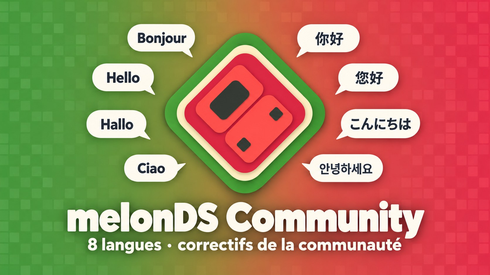
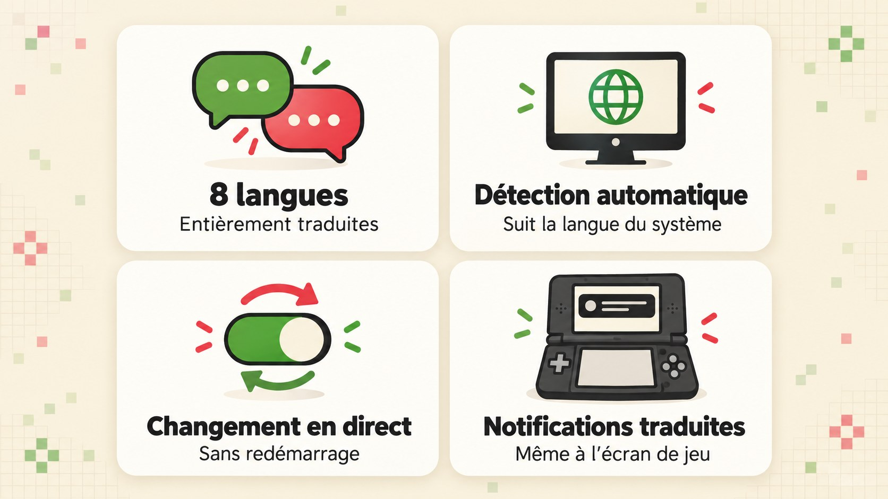
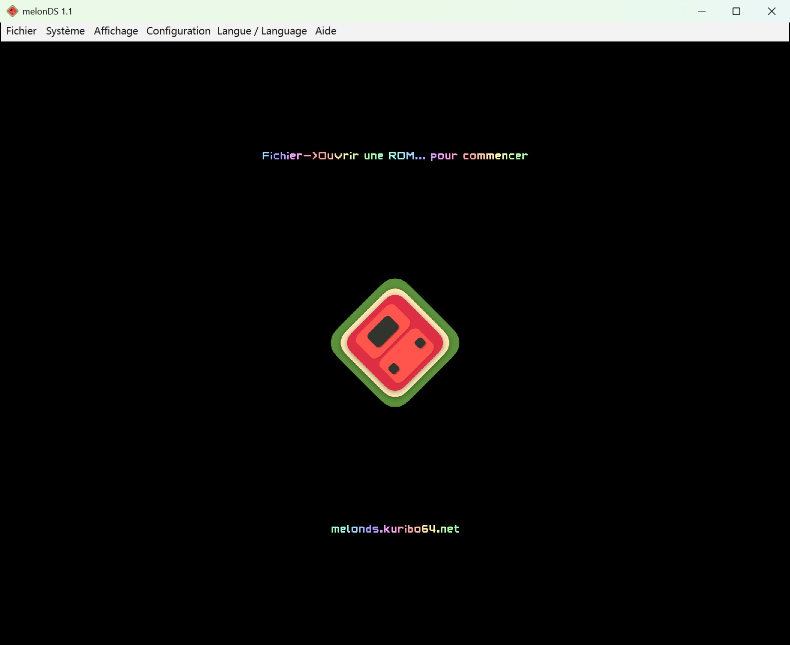
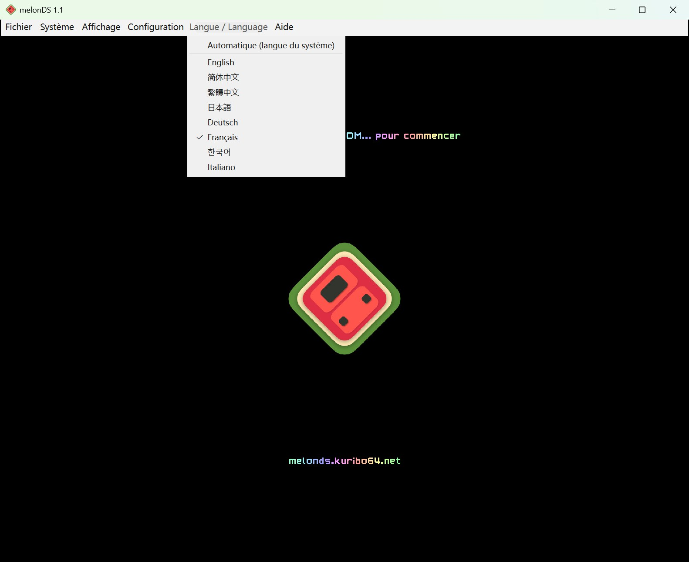
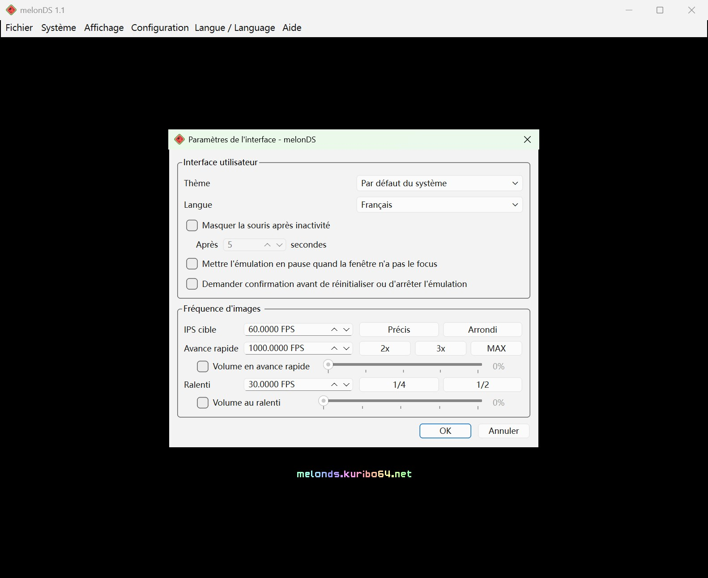
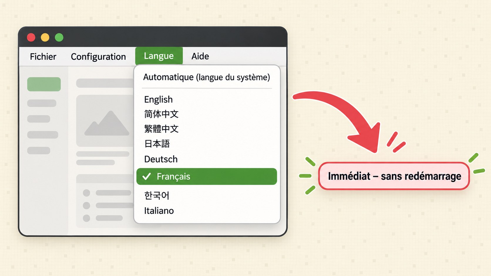
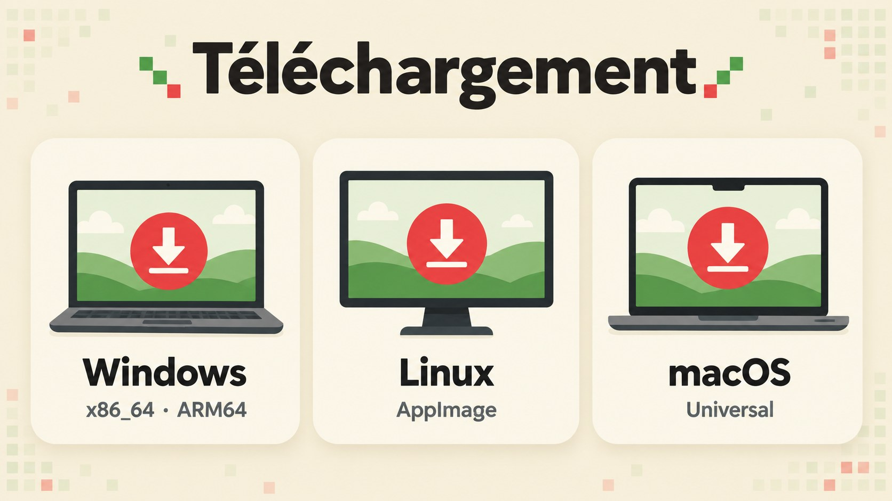
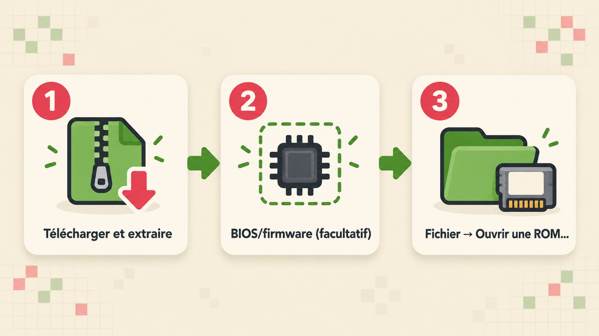

<p align="center"></p>

<p align="center">
<a href="../../README.md">English</a> ·
<a href="README.zh-CN.md">简体中文</a> ·
<a href="README.zh-TW.md">繁體中文</a> ·
<a href="README.ja.md">日本語</a> ·
<a href="README.de.md">Deutsch</a> ·
<b>Français</b> ·
<a href="README.ko.md">한국어</a> ·
<a href="README.it.md">Italiano</a>
</p>

<p align="center">
<a href="https://github.com/doomsday616/melonDS-community/releases/latest"></a>
<a href="https://github.com/doomsday616/melonDS-community/actions/workflows/build-windows.yml"></a>
<a href="https://github.com/doomsday616/melonDS-community/actions/workflows/build-ubuntu.yml"></a>
<a href="https://github.com/doomsday616/melonDS-community/actions/workflows/build-macos.yml"></a>
<a href="https://github.com/doomsday616/melonDS-community/actions/workflows/build-bsd.yml"></a>
<a href="https://www.gnu.org/licenses/gpl-3.0"></a>
</p>

# melonDS Community

Le projet melonDS d’origine est toujours maintenu, mais les nouvelles versions et l’intégration des pull requests sont lentes, et de nombreux correctifs et fonctionnalités proposés par la communauté attendent depuis longtemps d’être intégrés. **melonDS Community** est une édition communautaire non officielle : une interface en 8 langues, avec en plus des pull requests du projet d’origine, relues et de qualité, déjà intégrées. Ce projet n’est affilié ni à l’équipe de melonDS ni à Nintendo.

**melonDS Community** est un fork multilingue non officiel de l’émulateur Nintendo DS [melonDS](https://github.com/melonDS-emu/melonDS), basé sur la version 1.1. Le cœur d’émulation est strictement identique à celui du projet d’origine : seule l’interface Qt a été retravaillée pour une vraie localisation avec Qt Linguist. Menus, fenêtres de paramètres, messages et même notifications affichées à l’écran de jeu s’affichent ainsi dans votre langue.

## Fonctionnalités

<p align="center"></p>

- **8 langues entièrement traduites** – chaque langue couvre les 775 textes de l’interface.
- **Détection automatique** – au premier lancement, la langue du système est reprise.
- **Changement en direct** – changez de langue sans redémarrer l’émulateur.
- **Notifications à l’écran traduites (OSD)** – par exemple « État sauvegardé dans l'emplacement 1 » directement sur l’image du jeu.
- **Éléments Qt standard compris** – boutons comme « OK » / « Annuler » et sélecteurs de fichiers suivent la langue choisie (fichiers `qtbase_*.qm` intégrés).
- **Nouveau dans 1.1.0** – raccourcis configurables pour la sauvegarde/le chargement d’état rapide (emplacement 1) et pour la capture d’écran (dossier choisi dans les paramètres des chemins), confirmation facultative avant de réinitialiser ou d’arrêter (paramètres de l’interface), et fichiers `.srm` acceptés à l’import d’une sauvegarde.
- **Nouveau dans 1.2.0** – nouveaux raccourcis configurables pour faire défiler la disposition des écrans, basculer le dimensionnement égal, recharger la ROM la plus récente et masquer la barre de menus ; espace personnalisé entre les écrans (Affichage > Espace entre les écrans > Personnalisé...) ; curseurs de volume pour l’avance rapide et le ralenti (paramètres de l’interface) ; assignation automatique des manettes et assignations par modèle de manette, facultatives (désactivées par défaut, les assignations existantes sont conservées) ; résolution interne jusqu’à 22x ; le moteur de rendu OpenGL fonctionne désormais aussi en OpenGL 3.1.

## Captures d’écran

<p align="center">



</p>
<p align="center"><sub>Fenêtre principale · menu « Langue / Language » · fenêtre de paramètres – tout en français</sub></p>

## Langues prises en charge

| Langue | Code | Traduction |
|---|---|---|
| English (anglais) | `en` | Langue source |
| 简体中文 (chinois simplifié) | `zh_CN` | 775 / 775 |
| 繁體中文 (chinois traditionnel, vocabulaire de Taïwan) | `zh_TW` | 775 / 775 |
| 日本語 (japonais) | `ja` | 775 / 775 |
| Deutsch (allemand) | `de` | 775 / 775 |
| Français | `fr` | 775 / 775 |
| 한국어 (coréen) | `ko` | 775 / 775 |
| Italiano (italien) | `it` | 775 / 775 |

<p align="center"></p>

## Détection automatique et changement de langue

<p align="center"></p>

Par défaut, l’option **« Automatique (langue du système) »** est active. melonDS Community lit alors la langue d’affichage du système :

| Langue du système | Interface |
|---|---|
| Chinois traditionnel (zh-Hant, Taïwan, Hong Kong, Macao) | 繁體中文 |
| Chinois, toutes les autres variantes | 简体中文 |
| Japonais, allemand, français, coréen, italien | la langue correspondante |
| Toute autre langue | English |

Vous pouvez aussi choisir vous-même, à deux endroits toujours synchronisés :

1. Le menu **« Langue / Language »**, entre « Configuration » et « Aide ». La mention anglaise dans le titre permet de retrouver ce menu même dans une langue que l’on ne lit pas.
2. **Configuration → Paramètres de l'interface → Langue**.

Les noms de langue restent toujours écrits dans leur propre langue (English, 简体中文, 繁體中文, 日本語, Deutsch, Français, 한국어, Italiano). Le changement s’applique immédiatement, sans redémarrage ; une fenêtre déjà ouverte affiche la nouvelle langue dès que vous la rouvrez.

## Téléchargement

<p align="center"></p>

Tous les paquets sont disponibles sur [Releases → latest](https://github.com/doomsday616/melonDS-community/releases/latest) :

| Plateforme | Fichier |
|---|---|
| Windows (x86_64) | `melonDS-community-1.2.2-windows-x86_64.zip` |
| Windows (ARM64) | `melonDS-community-1.2.2-windows-arm64.zip` |
| Linux (x86_64) | `melonDS-community-1.2.2-linux-x86_64.AppImage` |
| Linux (aarch64) | `melonDS-community-1.2.2-linux-aarch64.AppImage` |
| macOS (Universal, Intel + Apple Silicon) | `melonDS-community-1.2.2-macos-universal.zip` |

L’archive Windows contient uniquement `melonDS.exe` et fonctionne en mode portable : rien n’est installé, les paramètres sont enregistrés dans `melonDS.toml`, dans le même dossier.

La version 1.2.0 intègre au total 38 corrections et fonctions issues de pull requests pas encore fusionnées dans melonDS : les 22 des versions précédentes et 16 nouvelles. Les [notes de version v1.2.0](https://github.com/doomsday616/melonDS-community/releases/tag/v1.2.0) détaillent les nouvelles, les notes de version [v1.1.0](https://github.com/doomsday616/melonDS-community/releases/tag/v1.1.0) et [v1.0.0](https://github.com/doomsday616/melonDS-community/releases/tag/v1.0.0) les précédentes.

## Démarrage rapide

<p align="center"></p>

1. **Télécharger et extraire** – récupérez le paquet adapté à votre système, décompressez-le (ou rendez l’AppImage exécutable) puis lancez-le.
2. **BIOS/firmware (facultatif)** – grâce au FreeBIOS intégré, de nombreux jeux démarrent directement sans aucun fichier. Pour démarrer sur le vrai menu du firmware ou utiliser le mode DSi, indiquez vos propres dumps dans **Configuration → Paramètres de l'émulateur** (onglets **Mode DS** et **Mode DSi**).
3. **Lancer un jeu** – choisissez votre ROM via **Fichier → Ouvrir une ROM...**.

## FAQ

**macOS indique que le développeur n’est pas identifié.**
Les builds ne sont pas signés. Essayez d’ouvrir l’application une fois, puis allez dans **Réglages Système → Confidentialité et sécurité**, section « Sécurité », cliquez sur **Ouvrir quand même** et confirmez avec votre mot de passe.

**Windows SmartScreen affiche un avertissement.**
Même cause : l’absence de signature. Cliquez sur **Informations complémentaires**, puis sur **Exécuter quand même**.

**Sous Linux, les caractères chinois, japonais ou coréens manquent dans les notifications à l’écran.**
Ces notifications utilisent une police du système pour ces caractères. Installez une police CJK, par exemple Noto Sans CJK – `fonts-noto-cjk` sous Debian/Ubuntu, `noto-fonts-cjk` sous Arch, `google-noto-sans-cjk-fonts` sous Fedora – puis relancez melonDS.

**Ai-je besoin d’un BIOS ou d’un firmware ?**
Pas pour le démarrage direct : FreeBIOS est intégré. Pour démarrer sur le firmware, il faut des dumps issus de votre propre DS ou DS Lite ; le firmware de 128 Ko du mode DS d’une DSi ou d’une 3DS n’est pas amorçable. Le mode DSi nécessite les dumps du BIOS et de la NAND d’une DSi. La seule source légale est votre propre console – ce projet ne renvoie vers aucun site de téléchargement de BIOS ou de ROM.

**Après un changement de langue, une fenêtre ouverte reste dans l’ancienne langue.**
C’est normal : fermez-la et rouvrez-la.

**Où sont enregistrés les paramètres ?**
Sous Windows, dans `melonDS.toml` à côté de `melonDS.exe`. Sous Linux et macOS, dans le dossier `melonDS` de votre répertoire de configuration utilisateur (par exemple `~/.config/melonDS/`), sauf si un dossier `portable` se trouve à côté de l’exécutable.

## Contribuer aux traductions

<p align="center"></p>

1. Modifiez `src/frontend/qt_sdl/translations/melonDS_<langue>.ts` avec Qt Linguist (ou un éditeur de texte).
2. Après une modification du code, mettez à jour les textes et régénérez les fichiers `.qm` (commandes également rappelées en commentaire dans `src/frontend/qt_sdl/CMakeLists.txt`) :
   ```sh
   lupdate -no-obsolete -locations none src/frontend/qt_sdl -ts src/frontend/qt_sdl/translations/melonDS_*.ts
   lrelease src/frontend/qt_sdl/translations/melonDS_*.ts
   ```
3. Committez le fichier `.ts` et le `.qm` généré (`qtbase_<langue>.qm` et `translations.qrc` se trouvent dans le même dossier). Une nouvelle langue doit en plus être ajoutée à `translations.qrc`.
4. Ouvrez une pull request ou une issue ici : [doomsday616/melonDS-community/issues](https://github.com/doomsday616/melonDS-community/issues) – **et non** sur le projet melonDS d’origine.

## Remerciements et licence

- Émulateur : l’équipe melonDS (Arisotura et les contributeurs) – [melonDS-emu/melonDS](https://github.com/melonDS-emu/melonDS). Les instructions de compilation et les crédits complets s’y trouvent.
- Icône : limittox.
- Dessins de manette de la fenêtre de configuration des commandes : adaptés d’illustrations de [Dimensions.com](https://www.dimensions.com), utilisés avec autorisation (voir [LICENSE.md](../../src/frontend/qt_sdl/InputConfig/resources/LICENSE.md)).

- Licence : [GNU GPLv3](https://www.gnu.org/licenses/gpl-3.0), comme le projet d’origine.

melonDS Community est un projet non officiel, sans lien avec Nintendo ni avec l’équipe melonDS.
