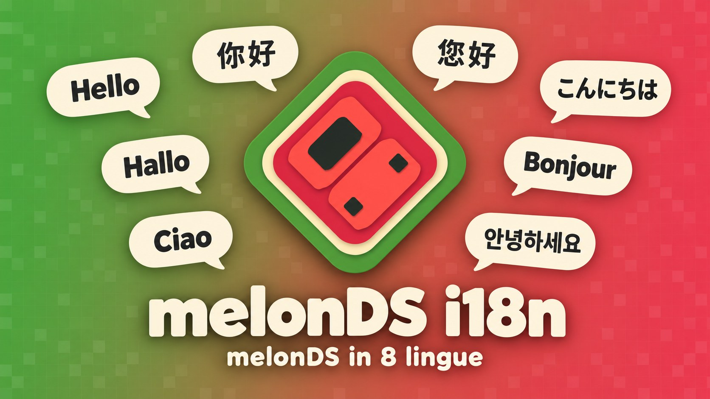
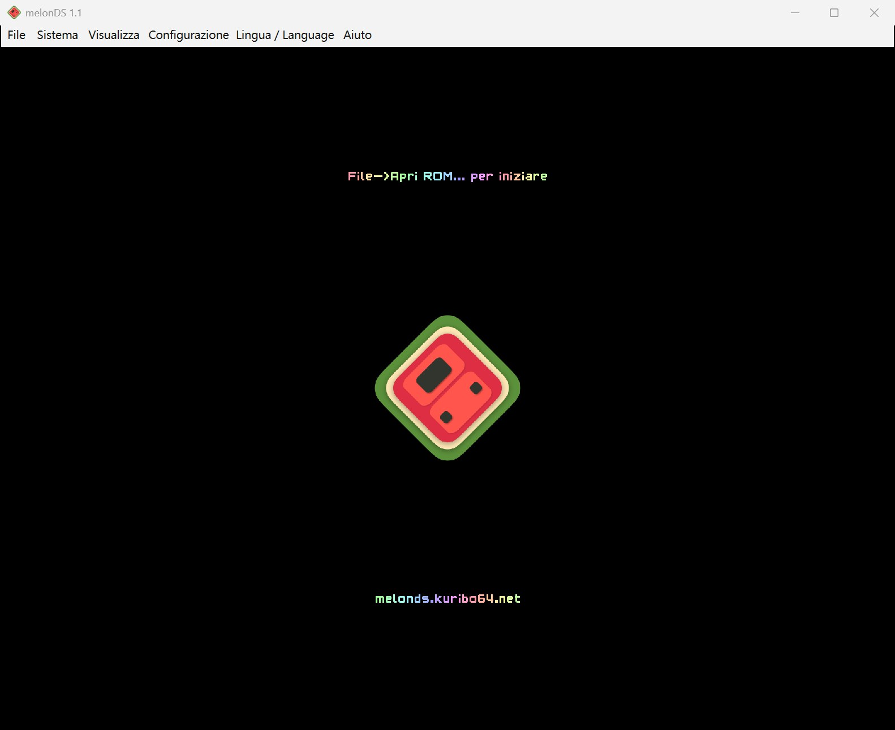
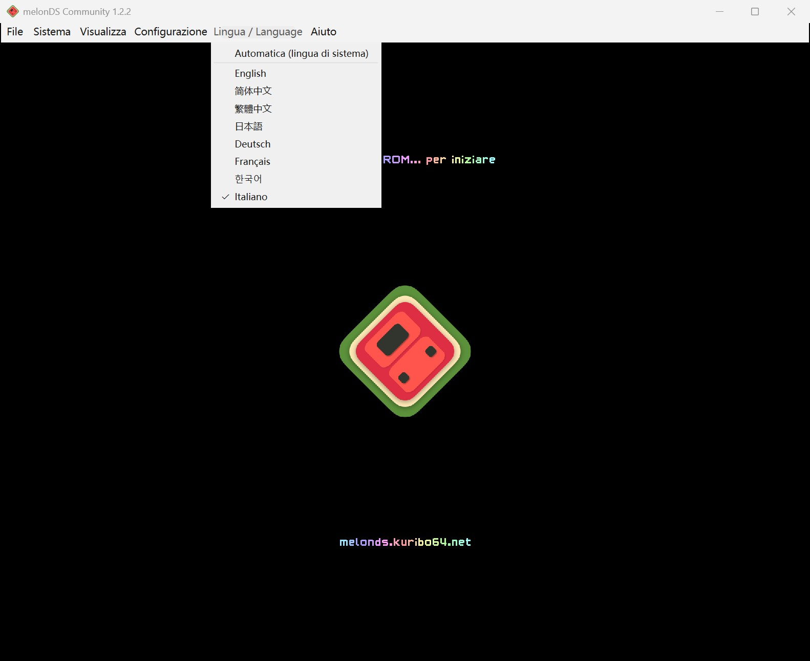
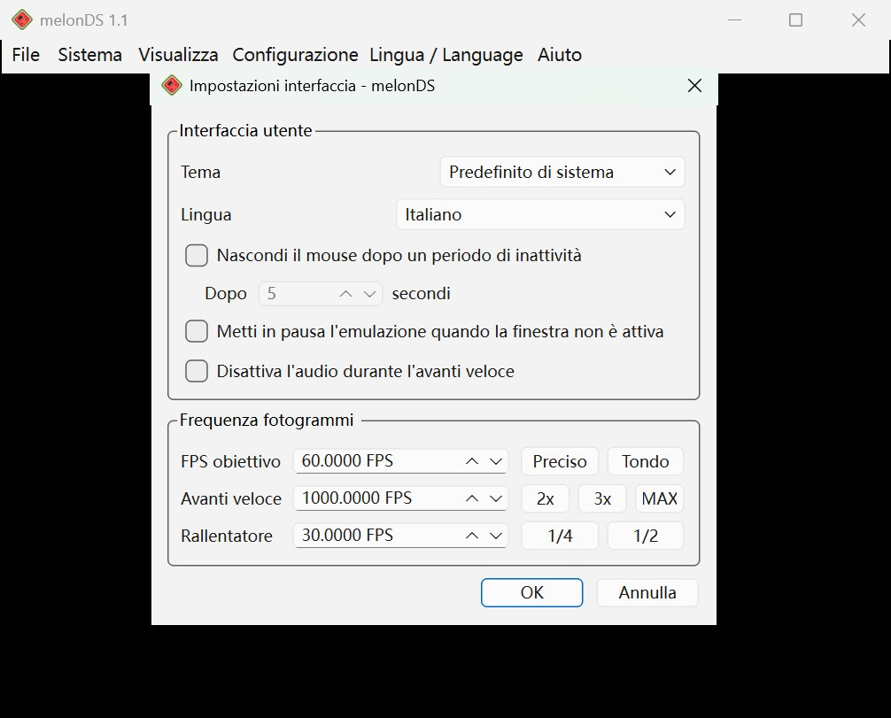
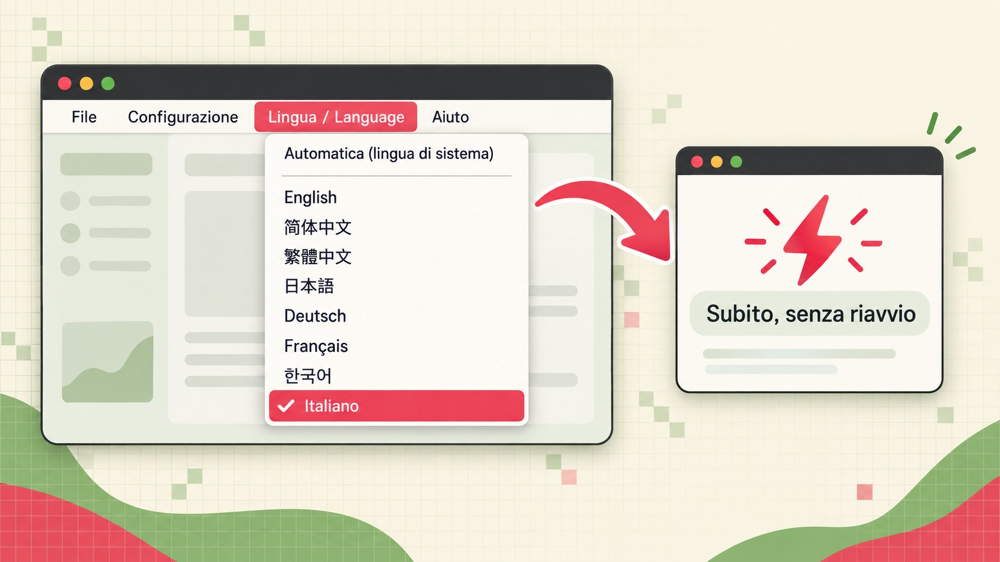
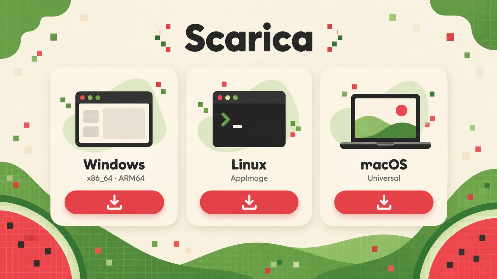
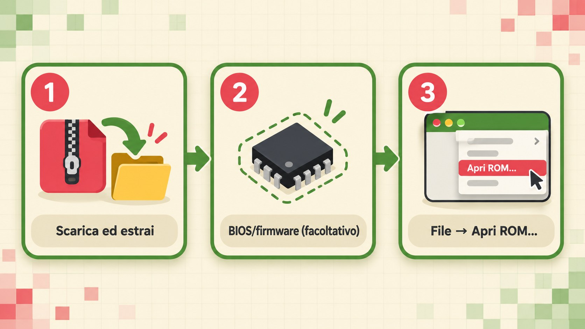

<p align="center"></p>

<p align="center">
<a href="../../README.md">English</a> ·
<a href="README.zh-CN.md">简体中文</a> ·
<a href="README.zh-TW.md">繁體中文</a> ·
<a href="README.ja.md">日本語</a> ·
<a href="README.de.md">Deutsch</a> ·
<a href="README.fr.md">Français</a> ·
<a href="README.ko.md">한국어</a> ·
<b>Italiano</b>
</p>

<p align="center">
<a href="https://github.com/doomsday616/melonDS-i18n/releases/latest"></a>
<a href="https://github.com/doomsday616/melonDS-i18n/actions/workflows/build-windows.yml"></a>
<a href="https://github.com/doomsday616/melonDS-i18n/actions/workflows/build-ubuntu.yml"></a>
<a href="https://github.com/doomsday616/melonDS-i18n/actions/workflows/build-macos.yml"></a>
<a href="https://github.com/doomsday616/melonDS-i18n/actions/workflows/build-bsd.yml"></a>
<a href="https://www.gnu.org/licenses/gpl-3.0"></a>
</p>

# melonDS i18n

**melonDS i18n** è un fork non ufficiale e multilingue dell'emulatore Nintendo DS [melonDS](https://github.com/melonDS-emu/melonDS), basato sulla versione 1.1. Il core di emulazione è identico all'originale: l'unica parte modificata è il frontend Qt, riorganizzato in una vera localizzazione Qt Linguist. Menu, finestre delle impostazioni, messaggi e perfino le notifiche sovrimpresse sullo schermo di gioco compaiono nella tua lingua.

## Caratteristiche

<p align="center"></p>

- **8 lingue, traduzione completa** – ogni lingua copre tutte le 758 stringhe dell'interfaccia.
- **Rilevamento automatico** – al primo avvio viene usata la lingua del sistema operativo.
- **Cambio immediato** – cambi lingua senza riavviare l'emulatore.
- **Notifiche a schermo (OSD) tradotte** – per esempio «Stato salvato nello slot 1» direttamente sopra il gioco.
- **Anche gli elementi standard di Qt** – pulsanti comuni e finestre di selezione file seguono la lingua scelta (`qtbase_*.qm` incluso).
- **Novità della 1.1.0** – tasti rapidi assegnabili per salvataggio/caricamento rapido di stato (slot 1) e per catturare una schermata (cartella scelta nelle impostazioni percorsi), conferma facoltativa prima di Reset/Arresta (impostazioni interfaccia) e file `.srm` accettati nell'importazione dei salvataggi.

## Screenshot

<p align="center">



</p>
<p align="center"><sub>Da sinistra: finestra principale · menu «Lingua / Language» · impostazioni in italiano</sub></p>

## Lingue supportate

| Lingua | Codice | Traduzione |
| --- | --- | --- |
| English (inglese) | `en` | testo originale |
| 简体中文 (cinese semplificato) | `zh_CN` | 758/758 |
| 繁體中文 (cinese tradizionale, terminologia di Taiwan) | `zh_TW` | 758/758 |
| 日本語 (giapponese) | `ja` | 758/758 |
| Deutsch (tedesco) | `de` | 758/758 |
| Français (francese) | `fr` | 758/758 |
| 한국어 (coreano) | `ko` | 758/758 |
| Italiano | `it` | 758/758 |

<p align="center"></p>

## Rilevamento automatico e cambio lingua

<p align="center"></p>

L'impostazione predefinita è **Automatica (lingua di sistema)**, che sceglie in base alla lingua dell'interfaccia del sistema:

- cinese tradizionale (zh-Hant, Taiwan, Hong Kong, Macao) → 繁體中文
- qualsiasi altro cinese → 简体中文
- giapponese, tedesco, francese, coreano, italiano → la lingua corrispondente
- tutto il resto → English

Per scegliere a mano, apri il menu **Lingua / Language** nella barra dei menu, tra **Configurazione** e **Aiuto**. Quando l'interfaccia non è in inglese, il titolo riporta sempre anche «Language», così lo trovi anche senza conoscere la lingua attiva. Il menu contiene **Automatica (lingua di sistema)** e l'elenco delle lingue con il loro nome originale (English, 简体中文, 繁體中文, 日本語, Deutsch, Français, 한국어, Italiano). La stessa scelta è disponibile in **Configurazione → Impostazioni interfaccia → Lingua**, e le due opzioni restano sempre sincronizzate.

Il cambio è immediato e non richiede il riavvio. Le finestre già aperte mostrano la nuova lingua dopo averle chiuse e riaperte.

## Download

<p align="center"></p>

Scarica il file per la tua piattaforma dalla [pagina dell'ultima release](https://github.com/doomsday616/melonDS-i18n/releases/latest).

| Piattaforma | File |
| --- | --- |
| Windows (x86_64) | `melonDS-i18n-1.1.0-windows-x86_64.zip` |
| Windows (ARM64) | `melonDS-i18n-1.1.0-windows-arm64.zip` |
| Linux (x86_64) | `melonDS-i18n-1.1.0-linux-x86_64.AppImage` |
| Linux (aarch64) | `melonDS-i18n-1.1.0-linux-aarch64.AppImage` |
| macOS (Universal) | `melonDS-i18n-1.1.0-macos-universal.zip` |

L'archivio per Windows contiene solo `melonDS.exe` ed è portatile: non serve installare nulla e le impostazioni vengono salvate in `melonDS.toml` nella stessa cartella.

La versione 1.1.0 include in tutto 22 correzioni e funzioni basate su pull request non ancora integrate in melonDS: le 10 della 1.0.0 più 12 nuove. Le [note di rilascio v1.1.0](https://github.com/doomsday616/melonDS-i18n/releases/tag/v1.1.0) descrivono le nuove, le [note di rilascio v1.0.0](https://github.com/doomsday616/melonDS-i18n/releases/tag/v1.0.0) le precedenti.

## Guida rapida

<p align="center"></p>

1. **Scarica ed estrai** – prendi il file dalla tabella qui sopra ed estrailo in una cartella a piacere (su Linux basta rendere eseguibile l'AppImage).
2. **BIOS/firmware (facoltativo)** – grazie a FreeBIOS integrato, l'avvio diretto funziona senza file aggiuntivi. Per avviare dal firmware o usare la modalità DSi, indica i dump della tua console in **Configurazione → Impostazioni emulatore** (schede **Modalità DS** e **Modalità DSi**).
3. **Avvia una ROM** – scegli **File → Apri ROM...** e apri la ROM di un gioco che possiedi.

## Domande frequenti

**macOS dice che lo sviluppatore non è verificato.**
Le release non sono firmate. Prova ad aprire l'app una volta, poi vai in **Impostazioni di Sistema → Privacy e sicurezza**, sezione Sicurezza, fai clic su **Apri comunque** e conferma con la password.

**Windows SmartScreen blocca l'avvio.**
L'eseguibile non è firmato, quindi può comparire un avviso. Fai clic sul collegamento per le informazioni aggiuntive sotto il messaggio, poi su **Esegui comunque**.

**Su Linux il testo coreano/cinese/giapponese delle notifiche a schermo appare come quadratini.**
Le notifiche usano un font di sistema: installa un font CJK, per esempio Noto Sans CJK (`fonts-noto-cjk` su Debian/Ubuntu, `noto-fonts-cjk` su Arch, `google-noto-sans-cjk-fonts` su Fedora), poi riavvia melonDS.

**Servono file BIOS o firmware?**
Per l'avvio diretto no, FreeBIOS è integrato. Per avviare dal firmware servono i dump di un DS o DS Lite di tua proprietà; il firmware da 128 KB della modalità DS di DSi o 3DS non è avviabile. La modalità DSi richiede i dump di BIOS e NAND di un DSi. L'unica fonte legale è la tua console: questo progetto non rimanda a siti di download di ROM o BIOS.

**Ho cambiato lingua ma una finestra aperta è rimasta com'era.**
Chiudila e riaprila: le finestre già aperte si aggiornano alla riapertura.

**Dove vengono salvate le impostazioni?**
Su Windows in `melonDS.toml`, accanto a `melonDS.exe`. Su Linux e macOS nella cartella `melonDS` della directory di configurazione dell'utente (per esempio `~/.config/melonDS/`), a meno che accanto all'eseguibile non ci sia una cartella `portable`.

## Contribuire alle traduzioni

<p align="center"></p>

1. Fai un fork del repository e modifica `src/frontend/qt_sdl/translations/melonDS_<lingua>.ts`, comodamente con Qt Linguist.
2. Se sono cambiate le stringhe nel codice, aggiorna i `.ts` con `lupdate` dalla radice del repository:
   ```
   lupdate -no-obsolete -locations none src/frontend/qt_sdl -ts src/frontend/qt_sdl/translations/melonDS_*.ts
   ```
3. Rigenera i `.qm` con `lrelease` (anche i `.qm` vanno inclusi nel commit):
   ```
   lrelease src/frontend/qt_sdl/translations/melonDS_*.ts
   ```
4. Per una lingua nuova aggiungi anche `qtbase_<lingua>.qm` e la voce corrispondente in `translations.qrc`.
5. Apri una pull request. Errori di traduzione e problemi vanno segnalati nelle [issue di questo fork](https://github.com/doomsday616/melonDS-i18n/issues), non nel progetto melonDS originale.

## Riconoscimenti e licenza

- Emulatore: il team di melonDS (Arisotura e collaboratori) – [melonDS-emu/melonDS](https://github.com/melonDS-emu/melonDS). Lì trovi le istruzioni di compilazione e i crediti completi.
- Icona: limittox
- Licenza: [GNU GPLv3](https://www.gnu.org/licenses/gpl-3.0)

Questo è un fork non ufficiale, non affiliato al team di melonDS né a Nintendo.
