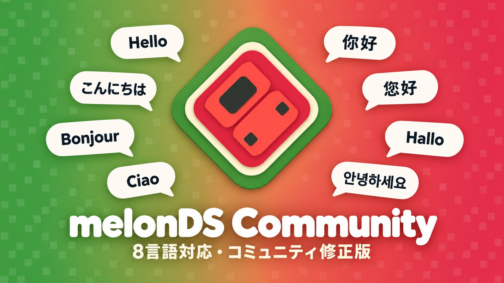
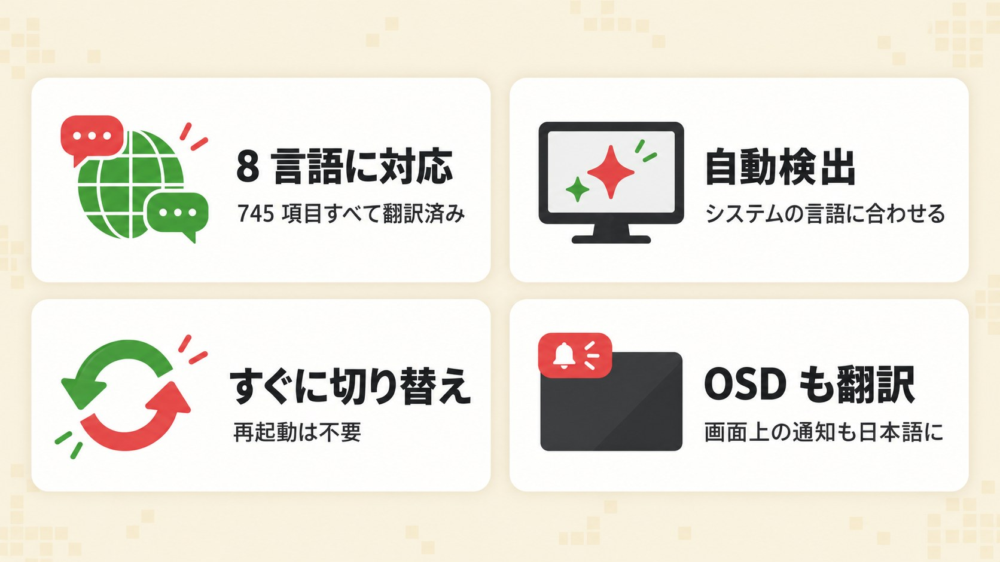
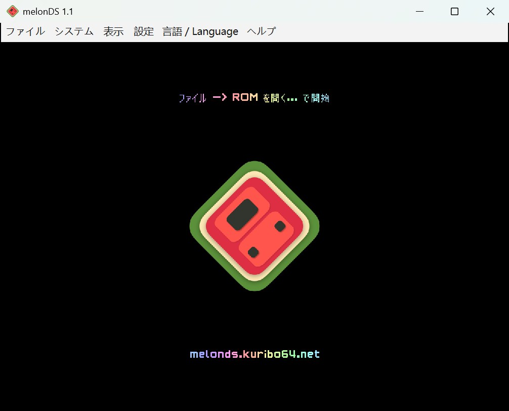
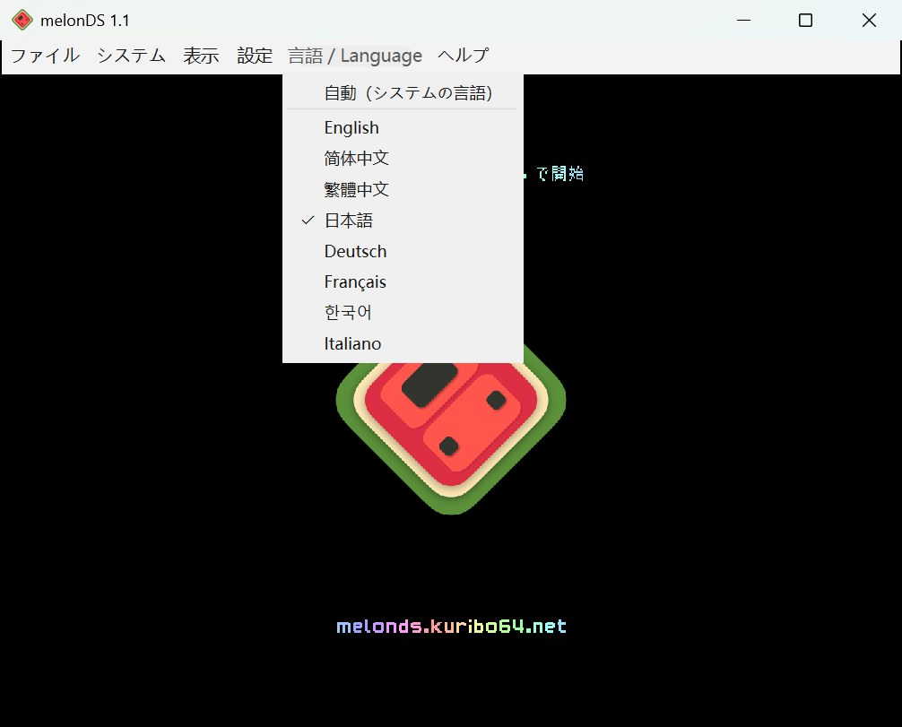
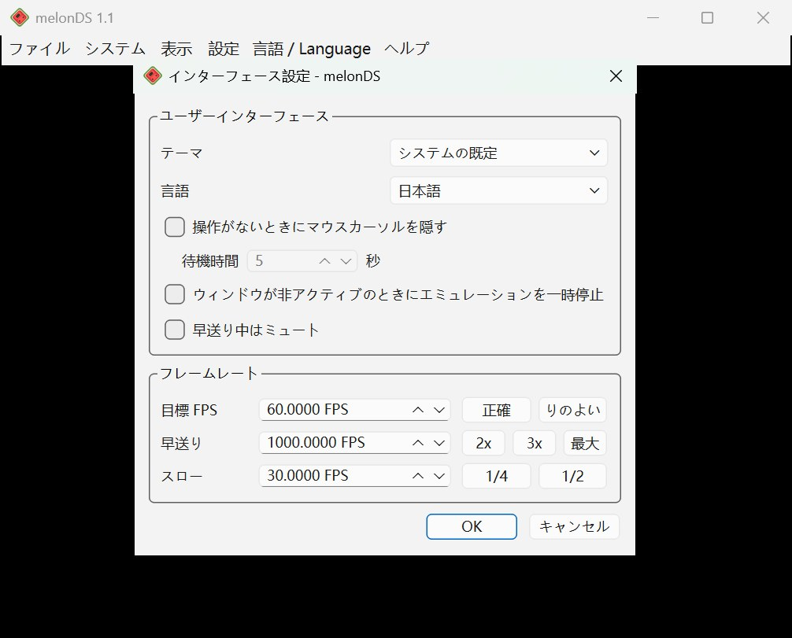
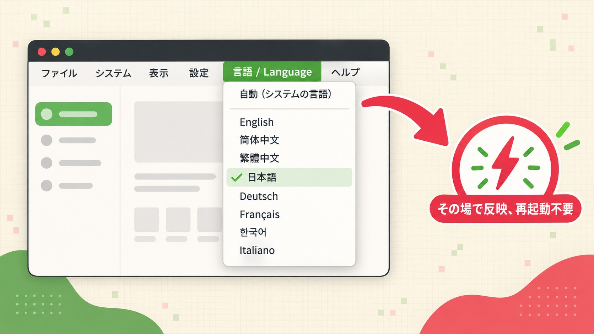
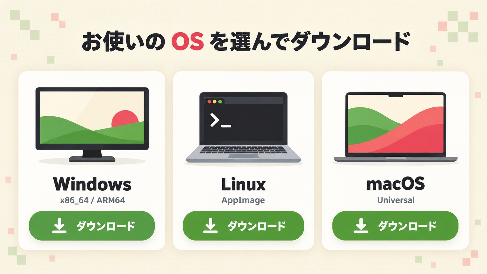
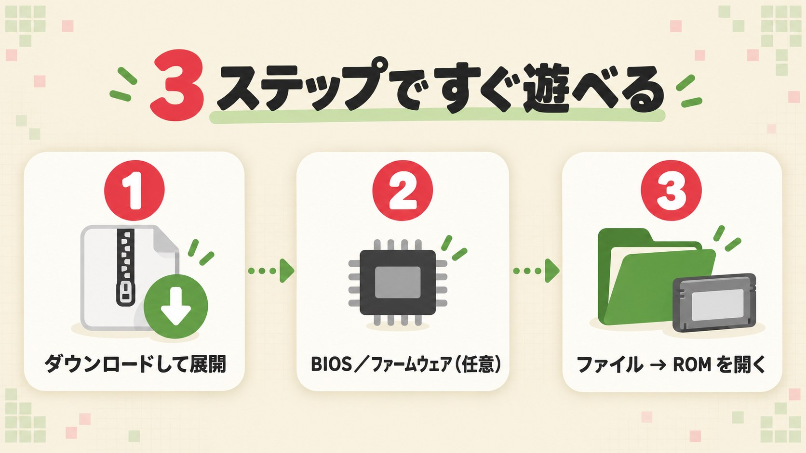

<a href="../../README.md">English</a> ·
<a href="README.zh-CN.md">简体中文</a> ·
<a href="README.zh-TW.md">繁體中文</a> ·
<b>日本語</b> ·
<a href="README.de.md">Deutsch</a> ·
<a href="README.fr.md">Français</a> ·
<a href="README.ko.md">한국어</a> ·
<a href="README.it.md">Italiano</a>

# melonDS Community

本家 melonDS は現在もメンテナンスされていますが、リリースや PR のマージには時間がかかり、コミュニティから提出された多くの修正や新機能が長いあいだマージされずに残っています。**melonDS Community** は非公式のコミュニティ版で、8 言語に対応した UI に加え、レビュー済みの質の高い本家 PR を取り込んでいます。melonDS チームおよび任天堂とは一切関係ありません。

**melonDS Community** は、ニンテンドー DS エミュレーター [melonDS](https://github.com/melonDS-emu/melonDS) の非公式な多言語版フォークです。melonDS 1.1 をベースにしており、エミュレーションのコアは本家とまったく同じなので、ゲームの動作も変わりません。違うのは Qt フロントエンドで、Qt Linguist を使った本格的な多言語（i18n）対応に作り替えています。メニュー、すべての設定画面、メッセージやエラー、さらにゲーム画面に表示される OSD 通知まで、お使いの言語で表示されます。現在 8 言語に対応し、いずれも翻訳済みです。

## 特長

- **8 言語に対応**：簡体字中国語、繁体字中国語（台湾の用語）、英語、日本語、ドイツ語、フランス語、韓国語、イタリア語。どの言語も 775 項目すべて翻訳済みです。
- **自動検出**：初回起動時に、システムの表示言語に合わせて言語を選びます。
- **すぐに切り替え**：メニューから言語を変えるとその場で反映され、再起動は不要です。
- **OSD も翻訳**：「スロット 1 にステートセーブしました」のような画面上の通知も日本語になります。Qt 標準のボタンやファイルダイアログも一緒に切り替わります。
- **1.1.0 の新機能**：クイックステートセーブ／ロード（スロット 1）とスクリーンショット用の割り当て可能なホットキー（保存先は「パス設定」で指定）、「インターフェース設定」でリセット・停止の前に確認するオプション、セーブファイルのインポートで `.srm` を選択可能。
- **1.2.0 の新機能**：画面レイアウトの順次切り替え、均等な画面サイズの切り替え、最近使った ROM の再読み込み、メニューバーの非表示に使える新しいホットキー。画面の間隔のカスタム値（「表示 > 画面の間隔 > カスタム...」）。早送り時・スロー時の音量スライダー（「インターフェース設定」）。コントローラーの自動割り当てと機種ごとの個別割り当て（どちらも既定ではオフ、既存の割り当てはそのまま）。内部解像度は最大 22 倍に。OpenGL レンダラーが OpenGL 3.1 でも動作するようになりました。

## スクリーンショット

 <em>日本語表示のメインウィンドウ</em>

 <em>「言語 / Language」メニュー。各言語はその言語自身の名前で並びます</em>

 <em>設定ダイアログもすべて日本語</em>

## 対応言語

| 言語 | コード | 状況 |
|---|---|---|
| 简体中文（簡体字中国語） | `zh_CN` | 775 / 775 |
| 繁體中文（繁体字中国語・台湾の用語） | `zh_TW` | 775 / 775 |
| English（英語） | `en` | 原文 |
| 日本語 | `ja` | 775 / 775 |
| Deutsch（ドイツ語） | `de` | 775 / 775 |
| Français（フランス語） | `fr` | 775 / 775 |
| 한국어（韓国語） | `ko` | 775 / 775 |
| Italiano（イタリア語） | `it` | 775 / 775 |

## 自動検出と言語の切り替え

初期設定では、melonDS Community はシステムの表示言語から言語を自動で選びます。

| システムの言語 | 表示される言語 |
|---|---|
| 中国語：繁体字、台湾・香港・マカオ（`zh-Hant`、`zh-TW`、`zh-HK`、`zh-MO`） | 繁體中文 |
| それ以外の中国語 | 简体中文 |
| 日本語、ドイツ語、フランス語、韓国語、イタリア語 | 同じ言語 |
| 上記以外 | English |

自分で言語を選ぶには：

- メニューバーの「**言語 / Language**」メニューを開きます（「設定」と「ヘルプ」の間にあります）。英語以外の表示ではメニュー名に現地語と Language が併記されるので、読めない言語に切り替えてしまっても元に戻せます。
- 「**自動（システムの言語）**」か、好きな言語を選びます。言語はすべてその言語自身の名前で表示されます：English、简体中文、繁體中文、日本語、Deutsch、Français、한국어、Italiano。
- 同じ設定は「**設定 → インターフェース設定 → 言語**」にもあり、両者は常に連動します。

切り替えはすぐに反映され、メニューや画面上の通知がその場で新しい言語になります。すでに開いているダイアログは、いったん閉じて開き直すと新しい言語になります。

## ダウンロード

最新版は [Releases ページ](https://github.com/doomsday616/melonDS-community/releases/latest)から入手できます。

| プラットフォーム | ファイル |
|---|---|
| Windows（x86_64、一般的な PC） | `melonDS-community-1.2.1-windows-x86_64.zip` |
| Windows（ARM64） | `melonDS-community-1.2.1-windows-arm64.zip` |
| Linux（x86_64） | `melonDS-community-1.2.1-linux-x86_64.AppImage` |
| Linux（aarch64） | `melonDS-community-1.2.1-linux-aarch64.AppImage` |
| macOS（Intel・Apple シリコン） | `melonDS-community-1.2.1-macos-universal.zip` |

Windows 版の zip には `melonDS.exe` が 1 つ入っているだけです。インストール不要のポータブル版で、設定は実行ファイルと同じフォルダーに保存されます。

バージョン 1.2.0 には、本家 melonDS にまだ取り込まれていないプルリクエストをもとにした修正・機能が計 38 件含まれています（以前のバージョンの 22 件と今回の 16 件）。今回の分は [v1.2.0 のリリースノート](https://github.com/doomsday616/melonDS-community/releases/tag/v1.2.0)、以前の分は [v1.1.0](https://github.com/doomsday616/melonDS-community/releases/tag/v1.1.0) と [v1.0.0](https://github.com/doomsday616/melonDS-community/releases/tag/v1.0.0) のリリースノートをご覧ください。

## クイックスタート

1. お使いのプラットフォーム用のファイルを**ダウンロードして展開**します（Linux では AppImage に実行権限を付けてから起動してください）。
2. **BIOS／ファームウェア（任意）**：内蔵の FreeBIOS のおかげで、ほとんどのゲームは吸い出しデータなしで直接起動できます。DS のファームウェアメニューから起動したい場合や DSi モードを使う場合は、「**設定 → エミュレーター設定**」の「**DS モード**」「**DSi モード**」タブで、自分で吸い出したファイルを指定してください。
3. 「**ファイル → ROM を開く...**」で、自分が所有するカートリッジから吸い出した ROM を選んで**ゲームを読み込みます**。

## よくある質問

**macOS で「開発元を確認できない」と表示される。**
ビルドに署名がないためです。一度アプリを開こうとしたあと、「**システム設定 → プライバシーとセキュリティ**」の「セキュリティ」で「**このまま開く**」をクリックし、ログインパスワードを入力してください。

**Windows SmartScreen の警告が出る。**
同じく実行ファイルに署名がないためです。「**詳細情報**」をクリックしてから「**実行**」を選んでください。

**Linux で、画面通知の日本語・中国語・韓国語が四角（豆腐）になる。**
OSD はシステムフォントで文字を描画します。Noto Sans CJK などの CJK フォント（Debian／Ubuntu なら `fonts-noto-cjk`、Arch なら `noto-fonts-cjk`、Fedora なら `google-noto-sans-cjk-fonts`）をインストールして、melonDS を再起動してください。

**BIOS やファームウェアとは何で、どこで入手できる？**
実機の中に入っている起動用プログラムと設定データです。melonDS には FreeBIOS が内蔵されているので、ゲームを直接起動するだけなら必要ありません。ファームウェアメニューから起動するには、初代 DS または DS Lite から吸い出したデータが必要です（DSi や 3DS の DS モード用 128 KB ファームウェアでは起動できません）。DSi モードには DSi の BIOS と NAND の吸い出しデータが必要です。合法な入手方法は、自分が所有する本体から吸い出すことだけです。本プロジェクトはダウンロードサイトへのリンクを一切掲載しません。

**言語を切り替えたのに、開いていたダイアログが古い言語のまま。**
仕様です。そのダイアログを閉じて、もう一度開いてください。

**設定はどこに保存される？**
Windows では `melonDS.exe` と同じフォルダーの `melonDS.toml` に保存されます。Linux と macOS では、ユーザー設定ディレクトリ内の `melonDS` フォルダー（例：`~/.config/melonDS/`）に保存されます。ただし、実行ファイルの隣に `portable` フォルダーがある場合はそちらが使われます。

## 翻訳に参加する

翻訳ファイルは [`src/frontend/qt_sdl/translations/`](../../src/frontend/qt_sdl/translations/) にある Qt Linguist 形式の `melonDS_<lang>.ts` です。コンパイル済みの `.qm`、Qt 本体の翻訳 `qtbase_<lang>.qm`、`translations.qrc` も同じ場所にコミットされており、実行ファイルに埋め込まれます。

1. 原文の文字列が変わった場合は、まず `.ts` を更新します：
   `lupdate -no-obsolete -locations none src/frontend/qt_sdl -ts src/frontend/qt_sdl/translations/melonDS_*.ts`
2. Qt Linguist で翻訳します（`.ts` の XML を直接編集しても構いません）。
3. 翻訳をコンパイルします：
   `lrelease src/frontend/qt_sdl/translations/melonDS_*.ts`
4. melonDS をビルドし直すと、`.qm` が `translations.qrc` 経由で埋め込まれます。

同じコマンドは `src/frontend/qt_sdl/CMakeLists.txt` のコメントにも書かれています。翻訳の不具合は本家 melonDS ではなく、[このリポジトリの Issues](https://github.com/doomsday616/melonDS-community/issues) に報告してください。

## クレジットとライセンス

- melonDS は melonDS チーム（Arisotura と貢献者の皆さん）によって開発されています。本家：[melonDS-emu/melonDS](https://github.com/melonDS-emu/melonDS)
- melonDS のアイコンは limittox によるものです。
- 入力設定画面のコントローラーの図は [Dimensions.com](https://www.dimensions.com) のイラストを改変したもので、許可を得て使用しています（[LICENSE.md](../../src/frontend/qt_sdl/InputConfig/resources/LICENSE.md) を参照）。
- ビルド方法や本家の完全なクレジットは [melonDS 公式リポジトリ](https://github.com/melonDS-emu/melonDS) をご覧ください。

melonDS Community は melonDS と同じく [GNU General Public License v3](https://www.gnu.org/licenses/gpl-3.0) で公開されているフリーソフトウェアです。

melonDS Community は非公式プロジェクトであり、任天堂および melonDS チームとは一切関係ありません。
