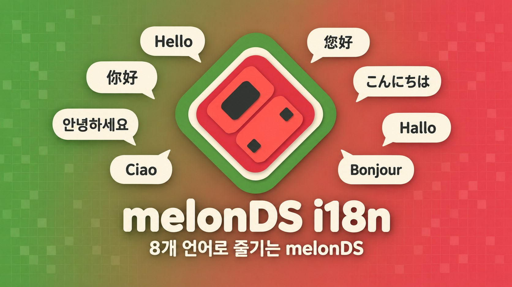
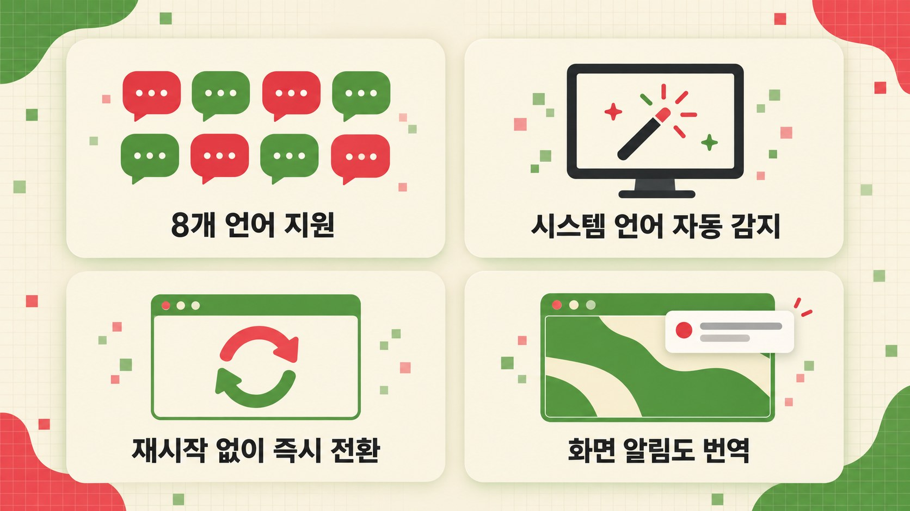
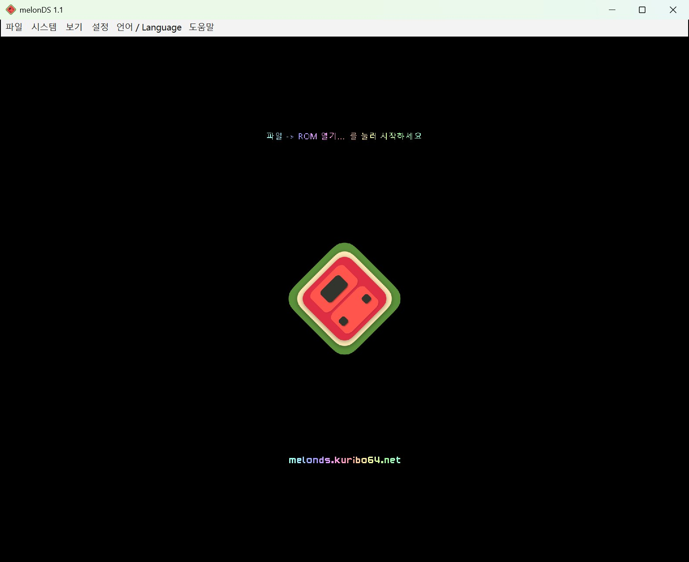
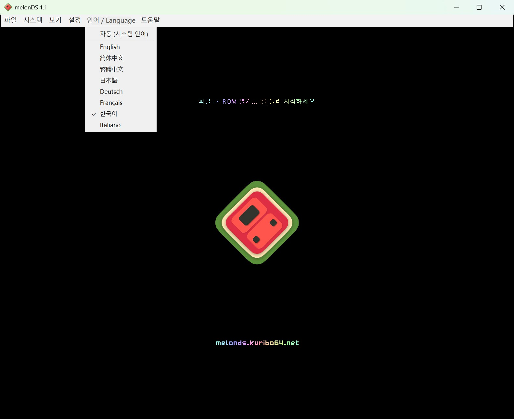
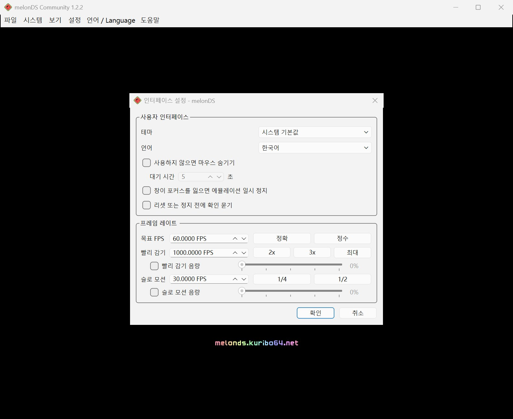
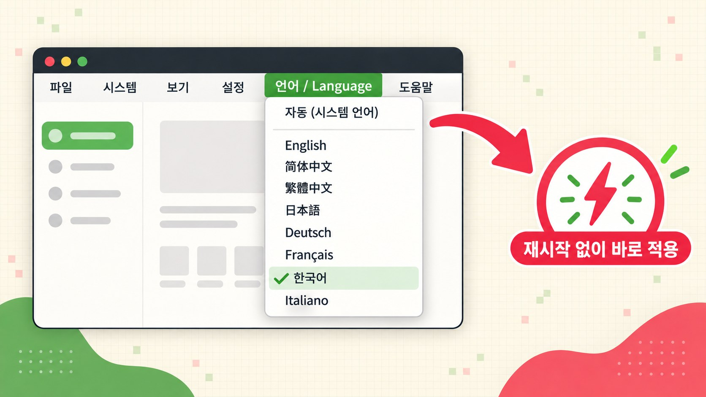
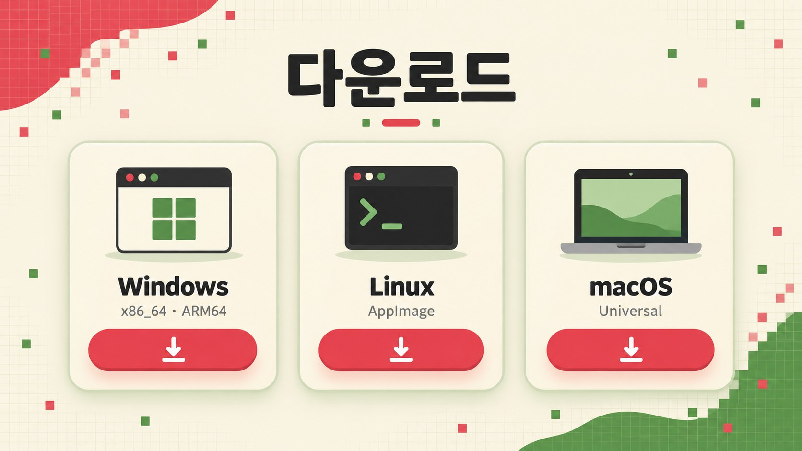
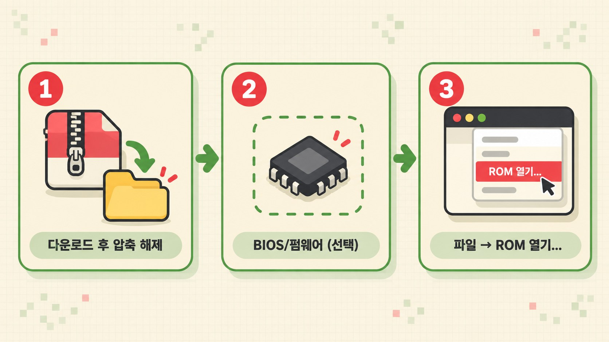

<p align="center"></p>

<p align="center">
<a href="../../README.md">English</a> ·
<a href="README.zh-CN.md">简体中文</a> ·
<a href="README.zh-TW.md">繁體中文</a> ·
<a href="README.ja.md">日本語</a> ·
<a href="README.de.md">Deutsch</a> ·
<a href="README.fr.md">Français</a> ·
<b>한국어</b> ·
<a href="README.it.md">Italiano</a>
</p>

<p align="center">
<a href="https://github.com/doomsday616/melonDS-community/releases/latest"></a>
<a href="https://github.com/doomsday616/melonDS-community/actions/workflows/build-windows.yml"></a>
<a href="https://github.com/doomsday616/melonDS-community/actions/workflows/build-ubuntu.yml"></a>
<a href="https://github.com/doomsday616/melonDS-community/actions/workflows/build-macos.yml"></a>
<a href="https://github.com/doomsday616/melonDS-community/actions/workflows/build-bsd.yml"></a>
<a href="https://www.gnu.org/licenses/gpl-3.0"></a>
</p>

# melonDS Community

원본 melonDS는 지금도 관리되고 있지만, 새 버전 출시와 PR 병합이 느려서 커뮤니티가 제출한 많은 수정 사항과 기능이 오랫동안 병합되지 않은 채 남아 있습니다. **melonDS Community**는 비공식 커뮤니티 에디션으로, 8개 언어를 지원하는 UI와 함께 검토를 거친 고품질 원본 PR을 병합해 두었습니다. melonDS 팀 및 닌텐도와는 아무런 관련이 없습니다.

> [!IMPORTANT]
> **이것은 공식 melonDS가 아닙니다.** 공식 에뮬레이터는 Arisotura와 melonDS 팀이 만든 [melonDS](https://github.com/melonDS-emu/melonDS)입니다. melonDS Community에서 문제가 생기면 melonDS 팀이 아니라 먼저 [여기](https://github.com/lazyalex616/melonDS-community/issues)에 알려 주세요. 공식 melonDS에서도 재현되는 문제만 원본 프로젝트에 보고해 주세요. melonDS 팀이 원한다면 이 번역은 원본 프로젝트에 제공할 예정입니다.

**melonDS Community**은 닌텐도 DS 에뮬레이터 [melonDS](https://github.com/melonDS-emu/melonDS) 1.1을 기반으로 한 비공식 다국어 포크입니다. 에뮬레이션 코어는 원본과 완전히 동일하며, 바뀐 부분은 Qt 프런트엔드뿐입니다. 프런트엔드를 Qt Linguist 방식의 제대로 된 다국어 구조로 다시 정리해서, 메뉴와 모든 설정 창, 메시지, 그리고 게임 화면 위에 뜨는 알림까지 한국어로 표시됩니다.

## 주요 기능

<p align="center"></p>

- **8개 언어 완전 번역** – 언어마다 인터페이스 문자열 775개를 모두 번역했습니다.
- **시스템 언어 자동 감지** – 처음 실행하면 운영체제의 표시 언어를 따라갑니다.
- **즉시 전환** – 에뮬레이터를 다시 시작하지 않고 바로 언어를 바꿀 수 있습니다.
- **화면 알림(OSD) 번역** – 예를 들어 "슬롯 1에 상태 저장됨" 같은 알림도 게임 화면에 한국어로 나옵니다.
- **Qt 기본 요소도 번역** – 표준 버튼과 파일 선택 창도 선택한 언어를 따릅니다(`qtbase_*.qm` 내장).
- **1.1.0 새 기능** – 빠른 상태 저장/불러오기(슬롯 1)와 스크린샷 찍기를 단축키로 지정할 수 있습니다(스크린샷 폴더는 "경로 설정"에서 지정). "인터페이스 설정"에서 리셋/정지 전에 확인을 묻도록 할 수 있고, 세이브 파일 가져오기에서 `.srm` 파일도 고를 수 있습니다.
- **1.2.0 새 기능** – 화면 배치 순환, 균등 화면 크기 전환, 최근 ROM 다시 불러오기, 메뉴 표시줄 숨기기용 새 단축키를 지정할 수 있습니다. 화면 간격을 직접 정할 수 있고("보기 > 화면 간격 > 사용자 지정..."), "인터페이스 설정"에 빨리 감기·슬로 모션 음량 슬라이더가 추가됐습니다. 컨트롤러 자동 매핑과 컨트롤러 모델별 매핑을 선택적으로 쓸 수 있습니다(둘 다 기본값은 꺼짐, 기존 매핑은 그대로 유지). 내부 해상도는 최대 22배까지, OpenGL 렌더러는 이제 OpenGL 3.1에서도 동작합니다.

## 스크린샷

<p align="center">



</p>
<p align="center"><sub>왼쪽부터: 메인 창 · "언어 / Language" 메뉴 · 한국어로 표시된 설정 창</sub></p>

## 지원 언어

| 언어 | 코드 | 번역 현황 |
| --- | --- | --- |
| English | `en` | 원문 |
| 简体中文 (중국어 간체) | `zh_CN` | 775/775 |
| 繁體中文 (중국어 번체, 대만 용어) | `zh_TW` | 775/775 |
| 日本語 (일본어) | `ja` | 775/775 |
| Deutsch (독일어) | `de` | 775/775 |
| Français (프랑스어) | `fr` | 775/775 |
| 한국어 | `ko` | 775/775 |
| Italiano (이탈리아어) | `it` | 775/775 |

<p align="center"></p>

## 자동 감지와 언어 전환

<p align="center"></p>

기본값은 **자동 (시스템 언어)** 입니다. 시스템 UI 언어에 따라 다음과 같이 선택됩니다.

- 중국어 번체 계열(zh-Hant, 대만·홍콩·마카오) → 繁體中文
- 그 밖의 중국어 → 简体中文
- 일본어 · 독일어 · 프랑스어 · 한국어 · 이탈리아어 → 해당 언어
- 그 외 모든 언어 → English

직접 고르고 싶다면 메뉴 막대의 **설정**과 **도움말** 사이에 있는 **언어 / Language** 메뉴를 여세요. 영어가 아닌 UI에서는 언어를 몰라도 찾을 수 있도록 제목에 항상 "Language"가 함께 붙습니다. 메뉴에는 **자동 (시스템 언어)** 와 각 언어가 원어 이름(English, 简体中文, 繁體中文, 日本語, Deutsch, Français, 한국어, Italiano)으로 나열됩니다. **설정 → 인터페이스 설정 → 언어** 에서도 같은 설정을 바꿀 수 있으며, 두 곳은 항상 동기화됩니다.

언어는 그 자리에서 바로 바뀌고 재시작이 필요 없습니다. 다만 이미 열려 있던 설정 창은 한 번 닫았다가 다시 열어야 새 언어로 표시됩니다.

## 다운로드

<p align="center"></p>

[최신 릴리스 페이지](https://github.com/doomsday616/melonDS-community/releases/latest)에서 내 플랫폼에 맞는 파일을 받으세요.

| 플랫폼 | 파일 |
| --- | --- |
| Windows (x86_64) | `melonDS-community-1.2.3-windows-x86_64.zip` |
| Windows (ARM64) | `melonDS-community-1.2.3-windows-arm64.zip` |
| Linux (x86_64) | `melonDS-community-1.2.3-linux-x86_64.AppImage` |
| Linux (aarch64) | `melonDS-community-1.2.3-linux-aarch64.AppImage` |
| macOS (Universal) | `melonDS-community-1.2.3-macos-universal.zip` |

Windows용 압축 파일에는 `melonDS.exe` 하나만 들어 있습니다. 설치가 필요 없는 포터블 방식이라 설정은 같은 폴더의 `melonDS.toml`에 저장됩니다.

1.2.0 버전에는 원본 melonDS에 아직 병합되지 않은 풀 리퀘스트를 바탕으로 한 수정과 기능이 모두 38개 들어 있습니다(이전 버전의 22개와 이번에 추가된 16개). 이번 항목은 [v1.2.0 릴리스 노트](https://github.com/doomsday616/melonDS-community/releases/tag/v1.2.0), 이전 항목은 [v1.1.0](https://github.com/doomsday616/melonDS-community/releases/tag/v1.1.0) 및 [v1.0.0](https://github.com/doomsday616/melonDS-community/releases/tag/v1.0.0) 릴리스 노트에서 볼 수 있습니다.

## 빠른 시작

<p align="center"></p>

1. **다운로드 후 압축 해제** – 위 표에서 파일을 받아 원하는 폴더에 풀어 둡니다(Linux는 AppImage에 실행 권한만 주면 됩니다).
2. **BIOS/펌웨어 (선택)** – 내장 FreeBIOS 덕분에 직접 부팅(direct boot)이라면 따로 파일이 없어도 됩니다. 펌웨어 부팅이나 DSi 모드가 필요하면 **설정 → 에뮬레이터 설정** 의 **DS 모드** · **DSi 모드** 탭에서 본인 기기에서 덤프한 파일을 지정하세요.
3. **ROM 실행** – **파일 → ROM 열기...** 를 선택해 본인이 가진 게임의 ROM 파일을 엽니다.

## 자주 묻는 질문

**macOS에서 "확인되지 않은 개발자" 경고가 떠요.**
릴리스는 서명되지 않은 빌드입니다. 앱을 한 번 열어 본 다음 **시스템 설정 → 개인정보 보호 및 보안**의 보안 항목에서 **그래도 열기**를 클릭하고 로그인 암호로 확인하세요.

**Windows SmartScreen이 실행을 막아요.**
서명되지 않은 실행 파일이라 경고가 나올 수 있습니다. **추가 정보 → 실행**을 누르면 됩니다.

**Linux에서 화면 알림의 한글이 네모로 보여요.**
화면 알림은 시스템 글꼴로 그려지므로 CJK 글꼴이 설치되어 있어야 합니다. Noto Sans CJK 같은 글꼴을 설치한 뒤(Debian/Ubuntu는 `fonts-noto-cjk`, Arch는 `noto-fonts-cjk`, Fedora는 `google-noto-sans-cjk-fonts`) melonDS를 다시 시작하세요.

**BIOS나 펌웨어 파일이 꼭 필요한가요?**
직접 부팅에는 필요 없습니다. FreeBIOS가 내장되어 있습니다. 펌웨어로 부팅하려면 본인이 가진 DS 또는 DS Lite에서 덤프한 파일이 필요하며, DSi나 3DS의 DS 모드 펌웨어(128KB)로는 부팅할 수 없습니다. DSi 모드에는 DSi BIOS와 NAND 덤프가 필요합니다. 합법적인 입수 방법은 본인 기기에서 직접 덤프하는 것뿐이며, 이 프로젝트는 ROM이나 BIOS 다운로드 사이트를 안내하지 않습니다.

**언어를 바꿨는데 열려 있던 창이 그대로예요.**
이미 열려 있던 창은 닫았다가 다시 열면 새 언어로 표시됩니다.

**설정은 어디에 저장되나요?**
Windows에서는 `melonDS.exe`와 같은 폴더의 `melonDS.toml`에 저장됩니다. Linux와 macOS에서는 사용자 설정 디렉터리의 `melonDS` 폴더(예: `~/.config/melonDS/`)에 저장되며, 실행 파일 옆에 `portable` 폴더가 있으면 그 폴더를 사용합니다.

## 번역 참여하기

<p align="center"></p>

1. 저장소를 포크하고 `src/frontend/qt_sdl/translations/melonDS_<언어>.ts` 를 수정합니다. Qt Linguist를 쓰면 편합니다.
2. 소스 문자열이 바뀌었다면 저장소 루트에서 `lupdate`로 `.ts`를 갱신합니다.
   ```
   lupdate -no-obsolete -locations none src/frontend/qt_sdl -ts src/frontend/qt_sdl/translations/melonDS_*.ts
   ```
3. `lrelease`로 `.qm`을 다시 만듭니다(`.qm`도 저장소에 커밋합니다).
   ```
   lrelease src/frontend/qt_sdl/translations/melonDS_*.ts
   ```
4. 새 언어를 추가할 때는 `qtbase_<언어>.qm`과 `translations.qrc` 항목도 함께 넣어 주세요.
5. 풀 리퀘스트를 보내 주세요. 오역이나 문제 제보는 [이 포크의 이슈](https://github.com/doomsday616/melonDS-community/issues)로 부탁드립니다. 업스트림 melonDS에는 올리지 말아 주세요.

## 크레딧 및 라이선스

- 에뮬레이터: melonDS 팀(Arisotura와 기여자들) – [melonDS-emu/melonDS](https://github.com/melonDS-emu/melonDS). 빌드 방법과 전체 크레딧은 해당 저장소에서 볼 수 있습니다.
- 아이콘: limittox
- 입력 설정 창의 컨트롤러 그림: [Dimensions.com](https://www.dimensions.com)의 일러스트를 수정한 것으로, 허가를 받아 사용합니다([LICENSE.md](../../src/frontend/qt_sdl/InputConfig/resources/LICENSE.md) 참고).
- 라이선스: [GNU GPLv3](https://www.gnu.org/licenses/gpl-3.0)

이 프로젝트는 비공식 포크이며 melonDS 팀이나 닌텐도와 관련이 없습니다.
