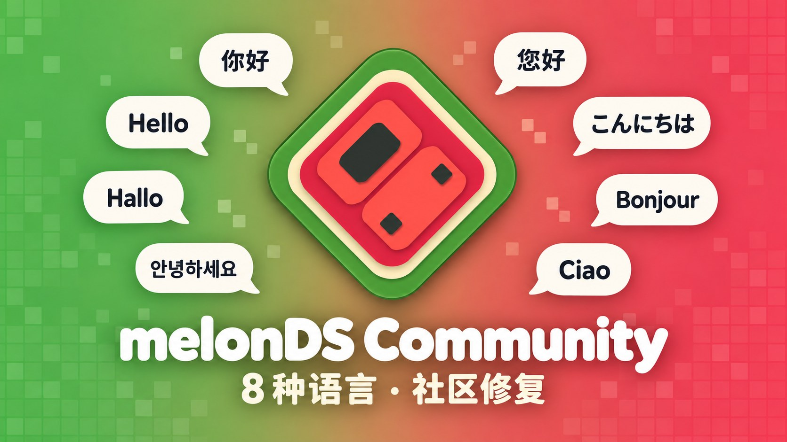
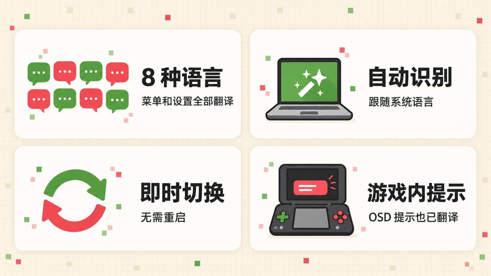
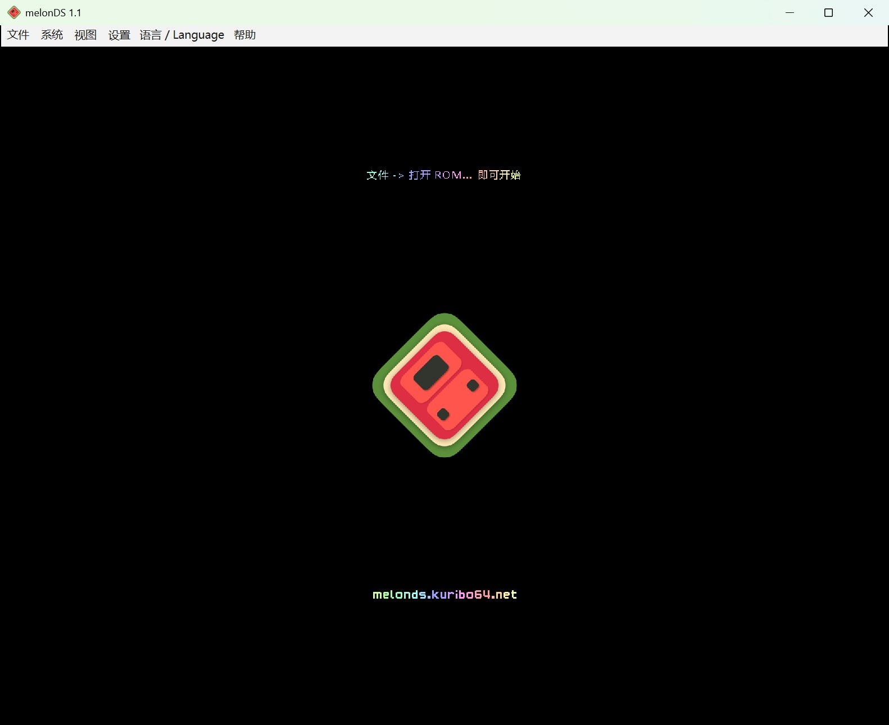
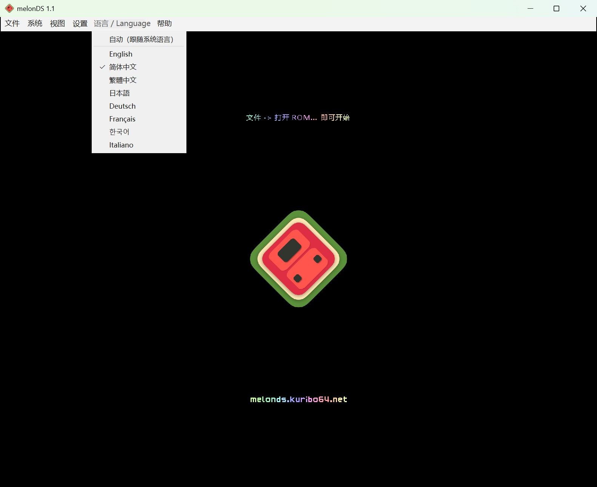
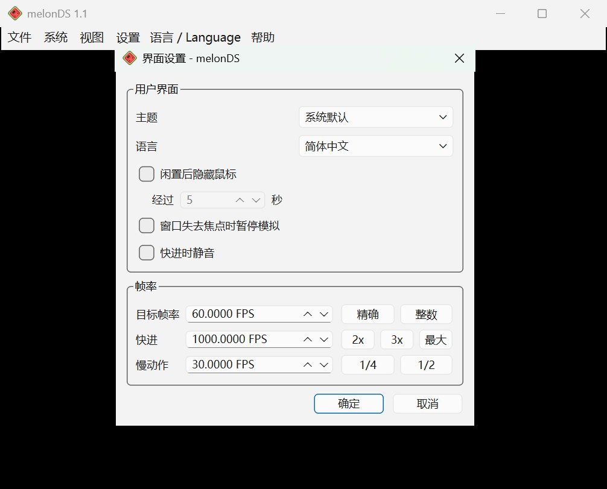
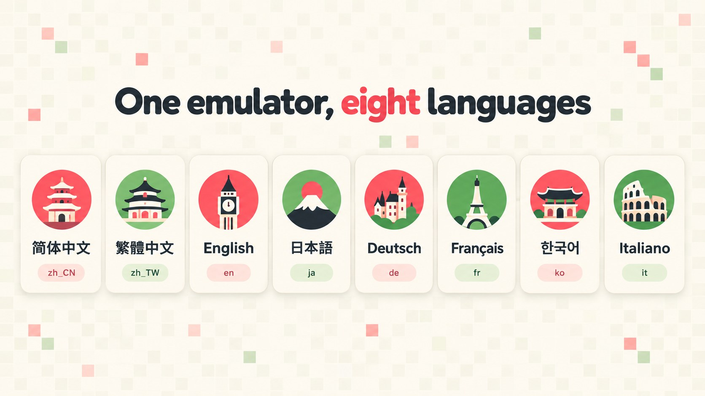
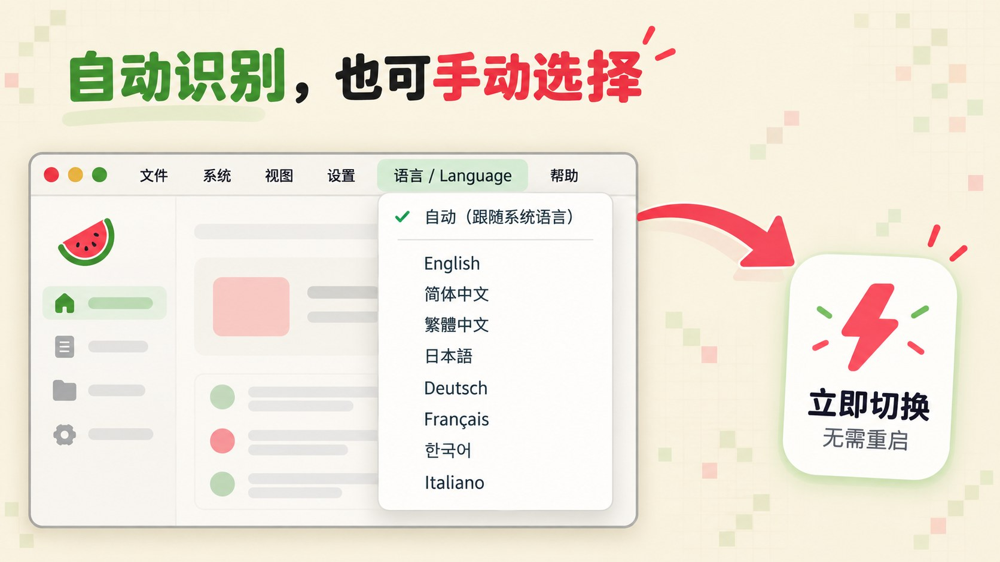
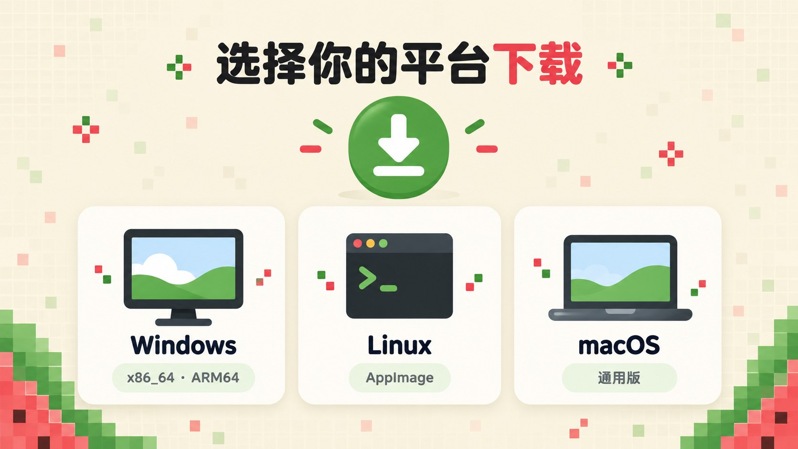
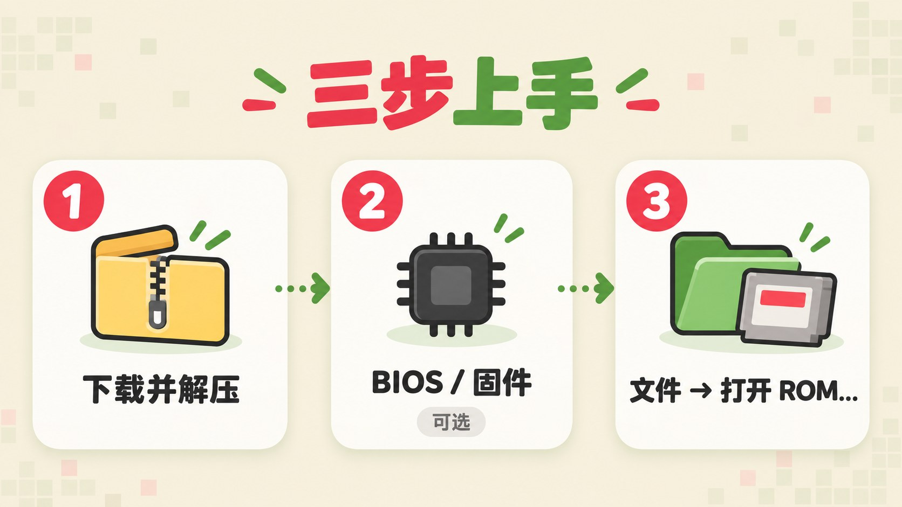
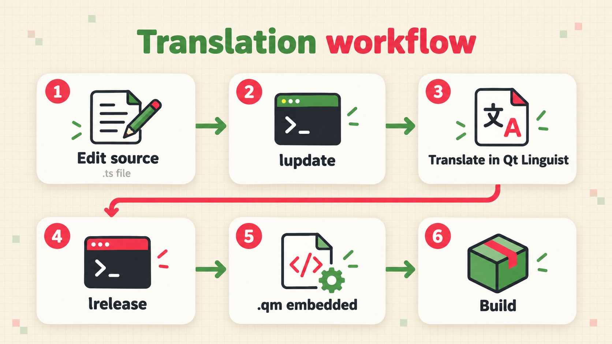

<a href="../../README.md">English</a> ·
<b>简体中文</b> ·
<a href="README.zh-TW.md">繁體中文</a> ·
<a href="README.ja.md">日本語</a> ·
<a href="README.de.md">Deutsch</a> ·
<a href="README.fr.md">Français</a> ·
<a href="README.ko.md">한국어</a> ·
<a href="README.it.md">Italiano</a>

# melonDS Community

上游 melonDS 仍在维护，但发版和合并 PR 都比较慢，不少社区提交的修复和新功能长期没有合并。**melonDS Community** 是一个非官方社区版：提供 8 种语言的界面，并合入了经过审阅的高质量上游 PR。本项目与 melonDS 团队及任天堂均无关联。

**melonDS Community** 是任天堂 DS 模拟器 [melonDS](https://github.com/melonDS-emu/melonDS) 的非官方多语言分支，基于 melonDS 1.1。模拟核心与上游完全一致，游戏运行效果没有任何区别；改动只在 Qt 界面上——它被改造成了标准的 Qt Linguist 多语言架构，菜单、所有设置窗口、提示与错误信息，乃至游戏画面上弹出的 OSD 提示，都会以你的语言显示。目前提供 8 种语言，每种都已完整翻译。

## 功能亮点

- **8 种语言**：简体中文、繁體中文（台湾用语）、English、日本語、Deutsch、Français、한국어、Italiano。
- **自动识别**：开箱即跟随系统语言，不用任何设置。
- **即时切换**：在菜单栏的 **语言 / Language** 里换语言，立刻生效，无需重启。
- **游戏内提示也翻译**：像“已保存即时存档到槽位 1”这样的 OSD 提示同样是中文，并用系统字体渲染中日韩文字和带重音的字母。
- **Qt 自带控件同步切换**：标准按钮、文件选择窗口也会跟着变成对应语言。
- **1.1.0 新增**：可绑定的快速保存/读取即时存档（槽位 1）热键和截图热键（截图文件夹可在“路径设置”里指定）；“界面设置”里可开启重置/停止前确认；导入存档时可直接选 `.srm` 文件。
- **1.2.0 新增**：新的可绑定热键，可循环切换屏幕布局、切换均等屏幕尺寸、重新加载最近的 ROM、隐藏菜单栏；自定义屏幕间距（“视图 > 屏幕间距 > 自定义...”）；快进和慢动作音量滑块（“界面设置”）；可选的手柄自动映射和按手柄型号单独映射（默认都关闭，原有映射保持不变）；内部分辨率最高 22 倍；OpenGL 渲染器现在也能在 OpenGL 3.1 上运行。

## 截图

 <em>主窗口</em>

 <em>“语言 / Language”菜单，每种语言都用它自己的文字显示</em>

 <em>设置窗口</em>

## 支持的语言

| 语言 | 代码 | 状态 |
|---|---|---|
| 简体中文 | `zh_CN` | 775 / 775 |
| 繁體中文（台湾用语） | `zh_TW` | 775 / 775 |
| English（英语） | `en` | 原文 |
| 日本語（日语） | `ja` | 775 / 775 |
| Deutsch（德语） | `de` | 775 / 775 |
| Français（法语） | `fr` | 775 / 775 |
| 한국어（韩语） | `ko` | 775 / 775 |
| Italiano（意大利语） | `it` | 775 / 775 |

## 自动识别与切换

默认情况下，melonDS Community 会根据系统界面语言自动选择：

| 系统语言 | 界面语言 |
|---|---|
| 繁体中文，或台湾、香港、澳门地区（`zh-Hant`、`zh-TW`、`zh-HK`、`zh-MO`） | 繁體中文 |
| 其他中文 | 简体中文 |
| 日语、德语、法语、韩语、意大利语 | 对应语言 |
| 其他语言 | English |

想自己指定语言：

- 点菜单栏上 **设置** 和 **帮助** 之间的 **语言 / Language** 菜单。非英文界面下它同时显示两种写法，就算界面换成了看不懂的语言，也能找回来。
- 选 **自动（跟随系统语言）**，或直接选某一种语言。各语言都用自己的文字列出：English、简体中文、繁體中文、日本語、Deutsch、Français、한국어、Italiano。
- 也可以在 **设置 → 界面设置 → 语言** 里选择，两处始终保持同步。

切换立即生效，菜单和游戏内提示当场变成新语言。切换前已经打开的窗口，关掉再打开一次就会更新。

## 下载

到 [Releases 页面](https://github.com/doomsday616/melonDS-community/releases/latest) 下载最新版本：

| 平台 | 文件 |
|---|---|
| Windows（x86_64，绝大多数电脑） | `melonDS-community-1.2.2-windows-x86_64.zip` |
| Windows（ARM64） | `melonDS-community-1.2.2-windows-arm64.zip` |
| Linux（x86_64） | `melonDS-community-1.2.2-linux-x86_64.AppImage` |
| Linux（aarch64） | `melonDS-community-1.2.2-linux-aarch64.AppImage` |
| macOS（Intel 与 Apple 芯片通用） | `melonDS-community-1.2.2-macos-universal.zip` |

Windows 压缩包里只有一个 `melonDS.exe`，属于绿色版：不用安装，设置文件就写在 exe 旁边。

1.2.0 版共合入 38 项基于上游 melonDS 尚未合并的 PR 的修复和功能：之前版本的 22 项，加上本版新增的 16 项。新增部分见 [v1.2.0 发布说明](https://github.com/doomsday616/melonDS-community/releases/tag/v1.2.0)，早先的见 [v1.1.0](https://github.com/doomsday616/melonDS-community/releases/tag/v1.1.0) 和 [v1.0.0](https://github.com/doomsday616/melonDS-community/releases/tag/v1.0.0) 发布说明。

## 快速上手

1. **下载并解压**对应平台的版本（Linux 下给 AppImage 加上可执行权限后直接运行）。
2. **BIOS / 固件（可选）**。melonDS 内置 FreeBIOS，大多数游戏不需要任何导出文件就能直接启动。如果想从 DS 固件菜单启动，或者使用 DSi 模式，请在 **设置 → 模拟器设置** 的 **DS 模式** 和 **DSi 模式** 标签页里配置你自己导出的文件。
3. **载入游戏**：点 **文件 → 打开 ROM...**，选择从你自己的卡带导出的 ROM。

## 常见问题

**macOS 提示“无法验证开发者”。**
程序没有签名。先尝试打开一次，然后到 **系统设置 → 隐私与安全** 的“安全性”部分点 **仍要打开**，再输入登录密码确认。

**Windows 弹出 SmartScreen 警告。**
同样是因为程序没有签名。点 **更多信息**，再点 **仍要运行**。

**Linux 下游戏内的中文提示显示成方块。**
OSD 提示用系统字体绘制文字。装一个中日韩字体即可，比如 Noto Sans CJK（Debian/Ubuntu 上是 `fonts-noto-cjk`，Arch 上是 `noto-fonts-cjk`，Fedora 上是 `google-noto-sans-cjk-fonts`），然后重启 melonDS。

**BIOS 和固件是什么，从哪里来？**
它们是真实 DS 主机里自带的启动程序和设置数据。melonDS 自带 FreeBIOS，所以直接启动游戏时可以不用。想从固件菜单启动，需要从原版 DS 或 DS Lite 导出（从 DSi 或 3DS 导出的 128 KB DS 模式固件无法用来启动）。DSi 模式需要 DSi 的 BIOS 和 NAND 导出文件。唯一合法的来源是从你自己的主机上导出；本项目不提供任何下载链接。

**切换了语言，但开着的窗口还是旧语言。**
这是正常的，关掉那个窗口再打开就好。

**设置保存在哪里？**
Windows 上保存在 `melonDS.exe` 旁边的 `melonDS.toml`。Linux 和 macOS 上保存在用户配置目录下的 `melonDS` 文件夹（例如 `~/.config/melonDS/`），除非程序旁边有一个 `portable` 文件夹。

## 参与翻译

翻译文件放在 [`src/frontend/qt_sdl/translations/`](../../src/frontend/qt_sdl/translations/)，是 Qt Linguist 格式的 `melonDS_<语言>.ts`。编译好的 `.qm`、Qt 自带的 `qtbase_<语言>.qm` 和 `translations.qrc` 也一并提交在这里，并会嵌入到程序里。

1. 如果源码里的字符串有变动，先更新 `.ts` 文件：
   `lupdate -no-obsolete -locations none src/frontend/qt_sdl -ts src/frontend/qt_sdl/translations/melonDS_*.ts`
2. 用 Qt Linguist 翻译（也可以直接编辑 `.ts` 的 XML）。
3. 编译翻译：
   `lrelease src/frontend/qt_sdl/translations/melonDS_*.ts`
4. 重新构建 melonDS，`.qm` 会通过 `translations.qrc` 嵌入程序。

这两条命令也写在 `src/frontend/qt_sdl/CMakeLists.txt` 的注释里。翻译问题请到[本仓库的 Issues](https://github.com/doomsday616/melonDS-community/issues) 反馈，不要提交到上游 melonDS。

## 致谢与许可证

- melonDS 由 melonDS 团队开发——Arisotura 及各位贡献者。上游仓库：[melonDS-emu/melonDS](https://github.com/melonDS-emu/melonDS)。
- melonDS 图标由 limittox 绘制。
- 输入设置窗口中的手柄示意图改编自 [Dimensions.com](https://www.dimensions.com) 的插图，已获授权使用（见 [LICENSE.md](../../src/frontend/qt_sdl/InputConfig/resources/LICENSE.md)）。
- 构建说明和完整的上游致谢名单请见 [melonDS 官方仓库](https://github.com/melonDS-emu/melonDS)。

melonDS Community 是自由软件，与 melonDS 一样以 [GNU 通用公共许可证 第 3 版（GPLv3）](https://www.gnu.org/licenses/gpl-3.0)发布。

melonDS Community 是非官方项目，与任天堂及 melonDS 团队均无关联。
