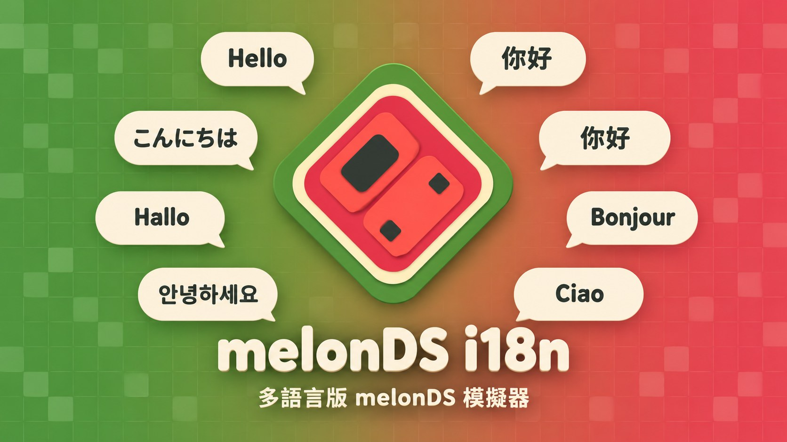
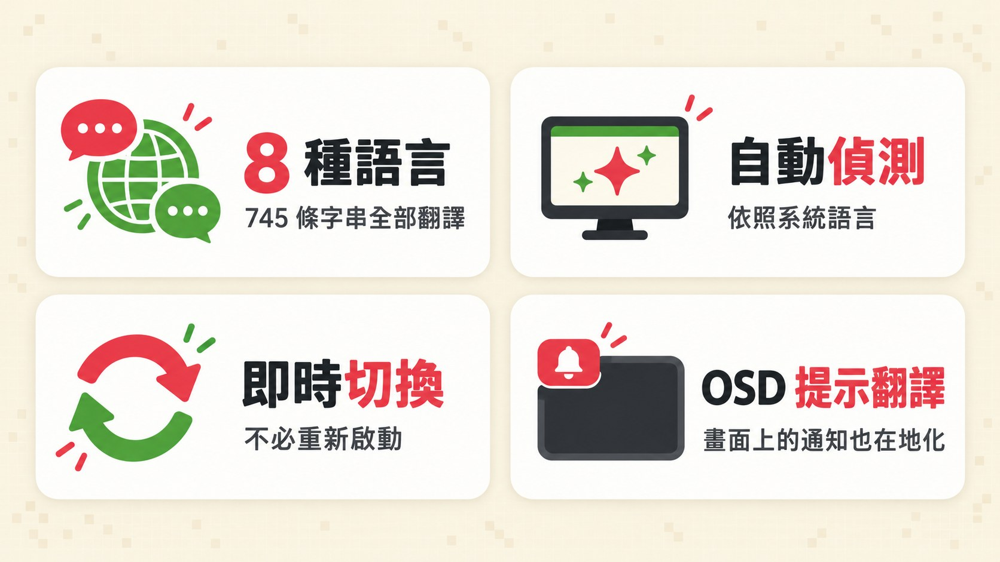
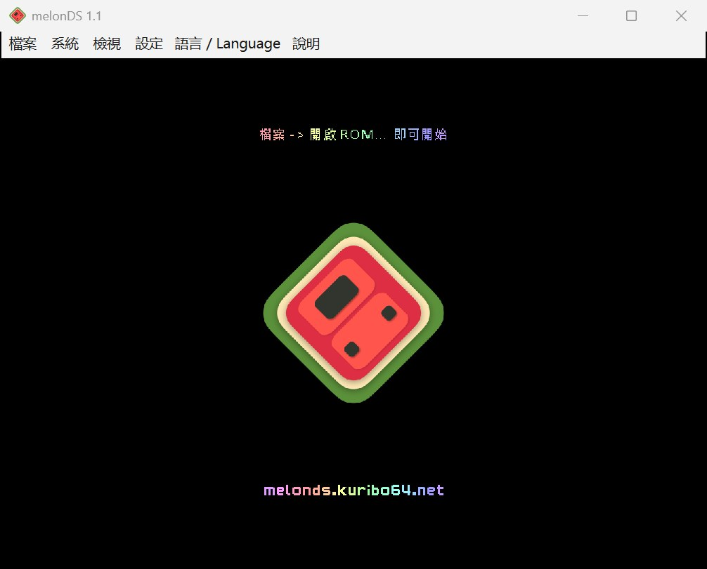
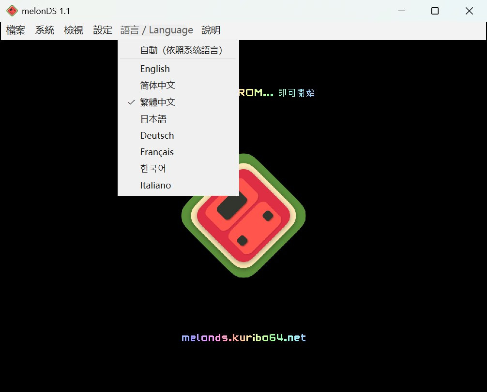
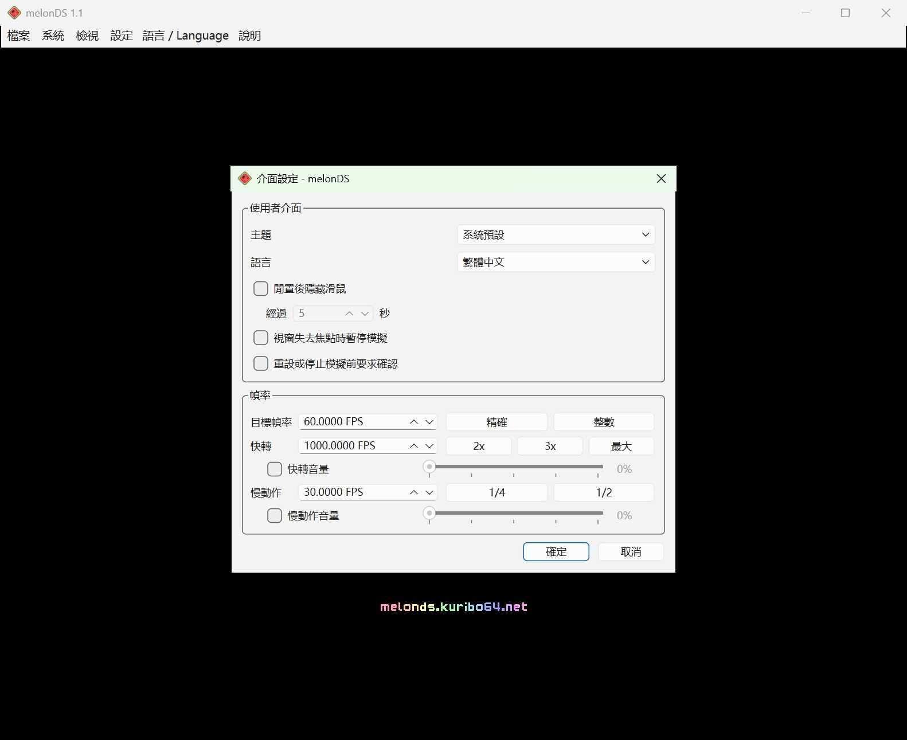
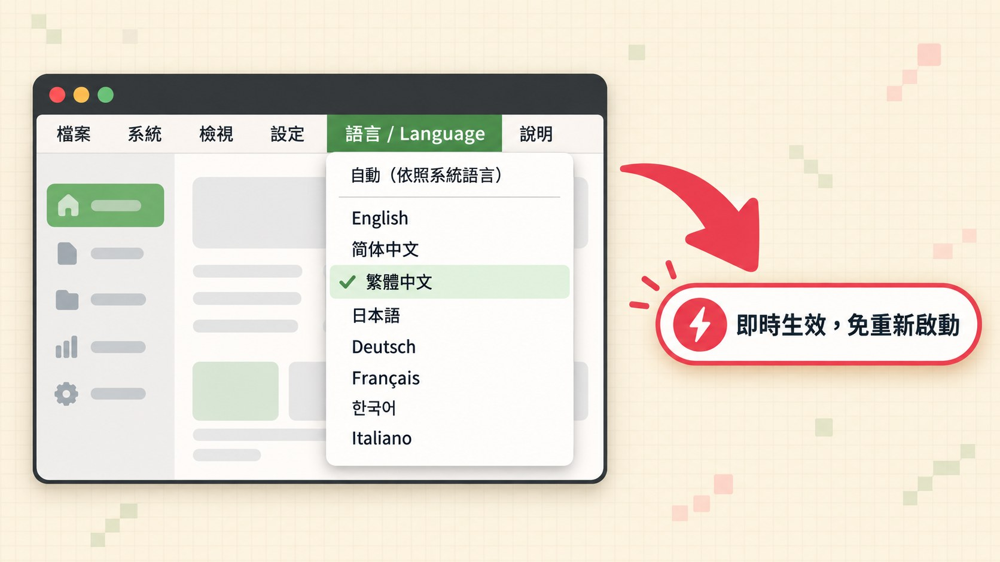
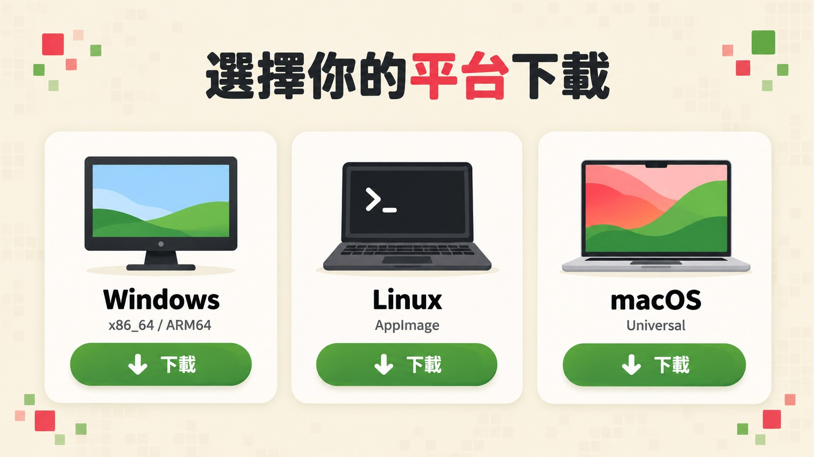
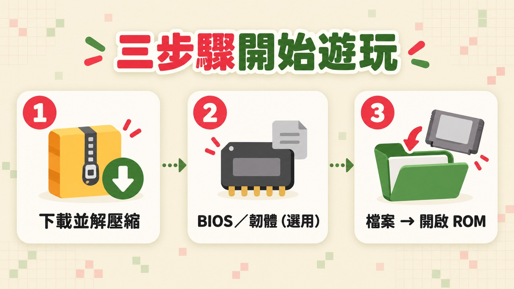

<a href="../../README.md">English</a> ·
<a href="README.zh-CN.md">简体中文</a> ·
<b>繁體中文</b> ·
<a href="README.ja.md">日本語</a> ·
<a href="README.de.md">Deutsch</a> ·
<a href="README.fr.md">Français</a> ·
<a href="README.ko.md">한국어</a> ·
<a href="README.it.md">Italiano</a>

# melonDS Community

上游 melonDS 仍在維護，但發版和合併 PR 都相當緩慢，許多社群提交的修正與新功能長期未被合併。**melonDS Community** 是非官方的社群版：提供 8 種語言的介面，並合併了經過審閱的高品質上游 PR。本專案與 melonDS 團隊及任天堂均無關聯。

> [!IMPORTANT]
> **這不是官方 melonDS。** 官方模擬器是 Arisotura 與 melonDS 團隊開發的 [melonDS](https://github.com/melonDS-emu/melonDS)。使用 melonDS Community 遇到問題，請先到[這裡](https://github.com/lazyalex616/melonDS-community/issues)回報，不要直接找 melonDS 團隊。只有在官方 melonDS 版本中也能重現的問題，才到上游回報。如果 melonDS 團隊需要，這些翻譯會提供給上游使用。

**melonDS Community** 是任天堂 DS 模擬器 [melonDS](https://github.com/melonDS-emu/melonDS) 的非官方多語言分支。它以 melonDS 1.1 為基礎，模擬核心與上游完全相同，遊戲跑起來一模一樣；不同的是 Qt 前端：整個介面改成標準的 Qt Linguist 多語言（i18n）架構，選單、所有設定視窗、提示與錯誤訊息，甚至遊戲畫面上跳出的 OSD 通知，都會以你的語言顯示。目前提供 8 種語言，全部翻譯完成。

## 特色

- **8 種語言**：簡體中文、繁體中文（台灣用語）、英文、日文、德文、法文、韓文、義大利文，每種語言 775 條字串全部翻譯。
- **自動偵測**：第一次啟動就依照系統的介面語言選好語言。
- **即時切換**：在選單裡換語言立刻生效，不必重新啟動。
- **OSD 也在地化**：像「已將即時存檔儲存至欄位 1」這類畫面上的通知也有翻譯；Qt 內建的標準按鈕與檔案對話框也會跟著切換。
- **1.1.0 新增**：可自訂的快速儲存/載入即時存檔（欄位 1）快速鍵與擷取畫面快速鍵（可在「路徑設定」指定擷取畫面資料夾）；「介面設定」可開啟重設/停止前確認；匯入存檔時可直接選擇 `.srm` 檔。
- **1.2.0 新增**：新的可自訂快速鍵，可循環切換螢幕配置、切換均等螢幕尺寸、重新載入最近的 ROM、隱藏選單列；自訂螢幕間距（「檢視 > 螢幕間距 > 自訂...」）；快轉與慢動作音量滑桿（「介面設定」）；可選的控制器自動對應與依控制器型號個別對應（預設皆關閉，原有對應保持不變）；內部解析度最高 22 倍；OpenGL 繪製器現在也能在 OpenGL 3.1 上執行。

## 螢幕截圖

 <em>繁體中文介面的主視窗</em>

 <em>「語言 / Language」選單，每種語言都以自己的名稱列出</em>

 <em>設定視窗同樣全部翻譯</em>

## 支援的語言

| 語言 | 代碼 | 狀態 |
|---|---|---|
| 简体中文（簡體中文） | `zh_CN` | 775 / 775 |
| 繁體中文（台灣用語） | `zh_TW` | 775 / 775 |
| English（英文） | `en` | 原文 |
| 日本語（日文） | `ja` | 775 / 775 |
| Deutsch（德文） | `de` | 775 / 775 |
| Français（法文） | `fr` | 775 / 775 |
| 한국어（韓文） | `ko` | 775 / 775 |
| Italiano（義大利文） | `it` | 775 / 775 |

## 自動偵測與切換語言

預設情況下，melonDS Community 會依照系統的介面語言自動選擇：

| 系統語言 | 介面語言 |
|---|---|
| 中文：繁體字或台灣、香港、澳門（`zh-Hant`、`zh-TW`、`zh-HK`、`zh-MO`） | 繁體中文 |
| 其他中文 | 简体中文 |
| 日文、德文、法文、韓文、義大利文 | 對應的語言 |
| 其他所有語言 | English |

想自己指定語言的話：

- 打開選單列上的「**語言 / Language**」選單（位在「設定」和「說明」之間）。非英文介面下，選單名稱會同時顯示本地名稱和 Language，所以就算切到看不懂的語言也找得回來。
- 選擇「**自動（依照系統語言）**」或任何一種語言。語言一律用自己的名稱列出：English、简体中文、繁體中文、日本語、Deutsch、Français、한국어、Italiano。
- 同一個選項也在「**設定 → 介面設定 → 語言**」裡，兩邊會保持同步。

切換會立即生效，選單和畫面上的通知當場就換成新語言。已經開著的對話視窗，關掉再重新開啟後才會套用新語言。

## 下載

請到 [Releases 頁面](https://github.com/doomsday616/melonDS-community/releases/latest)下載最新版本：

| 平台 | 檔案 |
|---|---|
| Windows（x86_64，大多數電腦） | `melonDS-community-1.2.3-windows-x86_64.zip` |
| Windows（ARM64） | `melonDS-community-1.2.3-windows-arm64.zip` |
| Linux（x86_64） | `melonDS-community-1.2.3-linux-x86_64.AppImage` |
| Linux（aarch64） | `melonDS-community-1.2.3-linux-aarch64.AppImage` |
| macOS（Intel 與 Apple 晶片） | `melonDS-community-1.2.3-macos-universal.zip` |

Windows 的 zip 裡只有一個 `melonDS.exe`。它是免安裝的可攜版，不會寫入系統，設定檔就存在執行檔旁邊。

1.2.0 版共收錄 38 項以上游 melonDS 尚未合併之 PR 為基礎的修正與功能：先前版本的 22 項，加上本版新增的 16 項。新增項目請見 [v1.2.0 發行說明](https://github.com/doomsday616/melonDS-community/releases/tag/v1.2.0)，先前的請見 [v1.1.0](https://github.com/doomsday616/melonDS-community/releases/tag/v1.1.0) 與 [v1.0.0](https://github.com/doomsday616/melonDS-community/releases/tag/v1.0.0) 發行說明。

## 快速上手

1. **下載並解壓縮**對應平台的版本（Linux 請先把 AppImage 設成可執行再開啟）。
2. **BIOS／韌體（選用）**：內建的 FreeBIOS 讓大部分遊戲不需要任何傾印檔就能直接啟動。如果想透過 DS 韌體選單開機，或使用 DSi 模式，請到「**設定 → 模擬器設定**」的「**DS 模式**」和「**DSi 模式**」分頁指定你自己傾印的檔案。
3. **載入遊戲**：用「**檔案 → 開啟 ROM...**」選擇你從自己擁有的卡匣傾印出來的 ROM。

## 常見問題

**macOS 說這個 App 來自未識別的開發者。**
這些版本沒有經過簽署。請先嘗試打開一次，再到「**系統設定 → 隱私權與安全性**」的「安全性」區段按「**強制打開**」，然後輸入登入密碼確認。

**Windows SmartScreen 跳出警告。**
原因相同：執行檔沒有簽署。按「**其他資訊**」，再按「**仍要執行**」。

**Linux 上，畫面通知裡的中文、日文、韓文變成方框。**
OSD 是用系統字型繪製文字的。請安裝 CJK 字型，例如 Noto Sans CJK（Debian／Ubuntu 上是 `fonts-noto-cjk`，Arch 上是 `noto-fonts-cjk`，Fedora 上是 `google-noto-sans-cjk-fonts`），然後重新啟動 melonDS。

**BIOS 和韌體是什麼？要去哪裡取得？**
它們是真實主機內部的開機程式和設定資料。melonDS 內建 FreeBIOS，所以直接啟動遊戲時並不需要它們。若要透過韌體選單開機，需要從原版 DS 或 DS Lite 傾印的檔案（DSi 或 3DS 在 DS 模式下的 128 KB 韌體無法用來開機）。DSi 模式則需要 DSi 的 BIOS 和 NAND 傾印檔。唯一合法的來源是從你自己擁有的主機傾印，本專案不會提供任何下載網站的連結。

**切換語言後，開著的視窗還是舊語言。**
這是正常的。把那個視窗關掉再重新開啟即可。

**設定存在哪裡？**
Windows 上存在 `melonDS.exe` 旁邊的 `melonDS.toml`。Linux 和 macOS 上存在使用者設定目錄下的 `melonDS` 資料夾（例如 `~/.config/melonDS/`）；若執行檔旁邊有 `portable` 資料夾，則改存在那裡。

## 參與翻譯

翻譯檔放在 [`src/frontend/qt_sdl/translations/`](../../src/frontend/qt_sdl/translations/)，是名為 `melonDS_<lang>.ts` 的 Qt Linguist 檔案。編譯好的 `.qm`、Qt 自己的 `qtbase_<lang>.qm` 以及 `translations.qrc` 也一起放在那裡，會內嵌進執行檔。

1. 如果原文字串有變動，先更新 `.ts` 檔：
   `lupdate -no-obsolete -locations none src/frontend/qt_sdl -ts src/frontend/qt_sdl/translations/melonDS_*.ts`
2. 用 Qt Linguist 翻譯（或直接編輯 `.ts` 的 XML）。
3. 編譯翻譯檔：
   `lrelease src/frontend/qt_sdl/translations/melonDS_*.ts`
4. 重新建置 melonDS，`.qm` 會透過 `translations.qrc` 內嵌進去。

完整指令也寫在 `src/frontend/qt_sdl/CMakeLists.txt` 的註解裡。翻譯問題請回報到[本專案的 Issues](https://github.com/doomsday616/melonDS-community/issues)，不要回報給上游 melonDS。

## 致謝與授權

- melonDS 由 melonDS 團隊（Arisotura 與各位貢獻者）開發。上游專案：[melonDS-emu/melonDS](https://github.com/melonDS-emu/melonDS)。
- melonDS 圖示由 limittox 設計。
- 輸入設定視窗中的控制器示意圖改編自 [Dimensions.com](https://www.dimensions.com) 的插圖，經授權使用（見 [LICENSE.md](../../src/frontend/qt_sdl/InputConfig/resources/LICENSE.md)）。
- 建置說明與完整的上游致謝名單請見 [melonDS 官方儲存庫](https://github.com/melonDS-emu/melonDS)。

melonDS Community 是自由軟體，與 melonDS 相同，以 [GNU General Public License v3](https://www.gnu.org/licenses/gpl-3.0) 授權釋出。

melonDS Community 是非官方專案，與任天堂及 melonDS 團隊皆無關聯。
